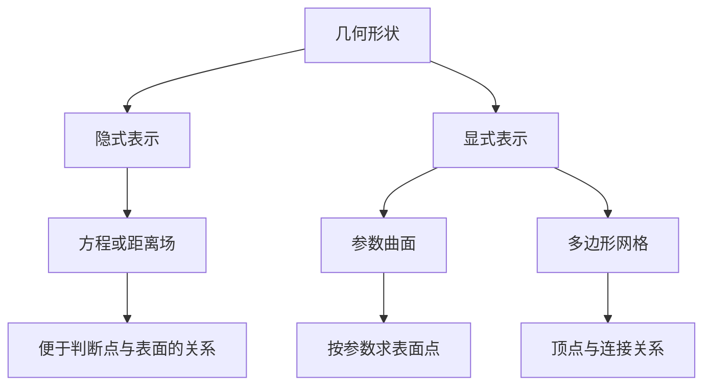
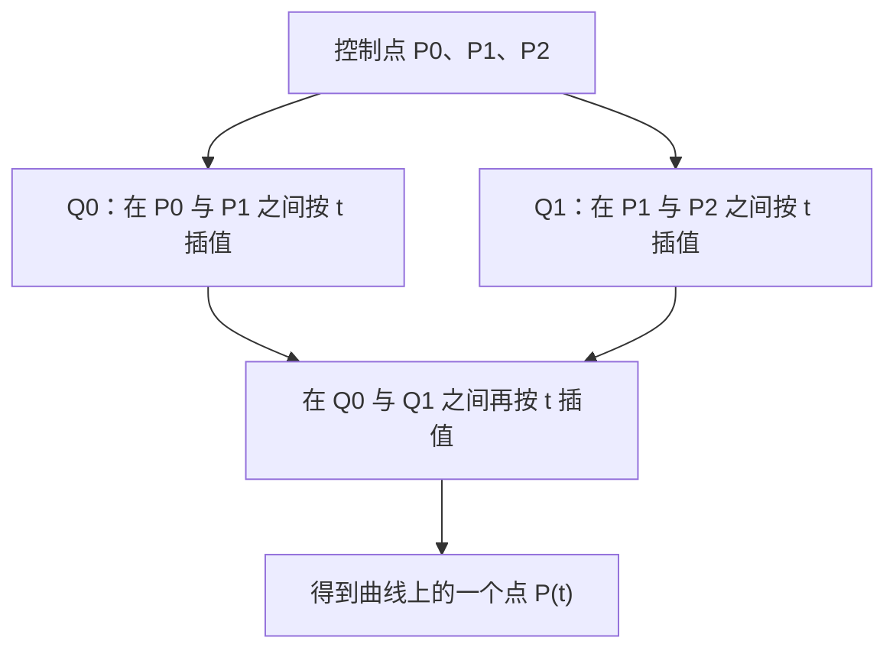

# 几何表示与曲面

渲染管线经常使用三角形，但形状并不只有三角网格这一种表示。几何表示决定了哪些操作容易进行：求表面点、判断内外、编辑局部形状，或计算光线与表面的交点。

## 一、隐式表示与显式表示

**隐式表示**用条件定义表面。单位球面可以写成 `x² + y² + z² - 1 = 0`。对这个特定函数，结果小于零表示球内，大于零表示球外，判断一个点的位置很直接；但要枚举表面上的点，需要额外方法。

**显式表示**直接给出表面上的点或组成单元。参数曲面用两个参数生成位置，三角网格则存储顶点以及连接关系。绘制和局部编辑通常更直接，但判断任意点是否在封闭物体内部，需要额外计算。

隐式函数不一定就是带符号距离函数。单位球的上述多项式能表示内外，却不直接等于点到球面的距离。使用距离场算法时，需要检查函数是否满足对应假设。

## 二、三角网格与拓扑

最基本的三角网格由顶点坐标和三角形索引组成。位置描述几何，哪些顶点与边相连描述拓扑。两个模型即使顶点位置相近，连接方式不同，也可能形成不同的表面。

法线还要区分两类：几何法线由三角形实际方向决定；着色法线可以在顶点存储并插值，用于表现平滑外观。平滑法线不增加轮廓上的几何细节。

网格也可能有边界、孔洞或非流形连接。渲染时能显示出来，并不意味着它适合体积计算、物理模拟或后续几何处理。

## 三、Bézier 曲线

给定两个控制点 `P0` 和 `P1`，线性插值得到线段上的点：`P(t) = (1-t)P0 + tP1`，其中 `t` 在 0 到 1 之间。

三个控制点可以先分别在线段 `P0P1` 和 `P1P2` 上插值，再对结果插值，得到二次 Bézier 曲线。增加控制点并重复同样的过程，就是 de Casteljau 算法。

曲线经过首尾控制点，但一般不经过中间控制点。移动中间控制点会改变曲线形状，而不是简单地把某个插值点拖到那里。

把曲线推广到两个参数方向，可以构造 Bézier 曲面。参数曲面适合平滑形状设计；进入常见光栅化管线时，通常还要离散成三角形。

## 四、细分、简化与重建

**网格细分**增加面数，并按特定规则调整顶点位置，可以逼近平滑曲面。它能改善几何连续性，却不会自动恢复原始模型中从未记录的细节。

**网格简化**在控制误差的前提下减少元素，例如逐步折叠边。减少三角形只是手段，还要关注轮廓、尖锐特征、UV 接缝与法线变化。

**网格重建**则从点云等离散观测恢复表面，需要面对噪声、孔洞和采样密度不均等问题。它与“给现有三角形再切几刀”处理的不是同一类输入。

## 五、形状精度与画面精度

远处的小球可能只占很少的像素，即使继续细分，最终画面变化也不明显。近处的球若轮廓明显呈多边形，仅改善法线或提高纹理分辨率又不能补足轮廓。

判断问题所在时，可以按顺序观察：轮廓是否正确，表面法线是否连续，纹理是否足够，屏幕采样是否充分。几何精度、着色细节和成像分辨率需要相互匹配。

## 参考资料

- [GAMES101 课程大纲](https://sites.cs.ucsb.edu/~lingqi/teaching/games101.html)：几何基本表示、曲线与曲面、网格处理。本文按概念组织，不对应逐课讲义。

[上一篇：着色与纹理](knowledge/bim/computer-graphics/materials-and-textures.md) · [下一篇：可见性与阴影](knowledge/bim/computer-graphics/light-and-shadow.md)
