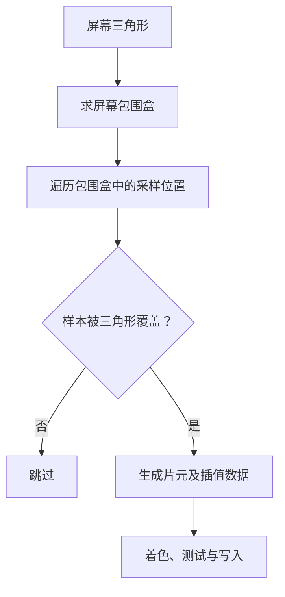
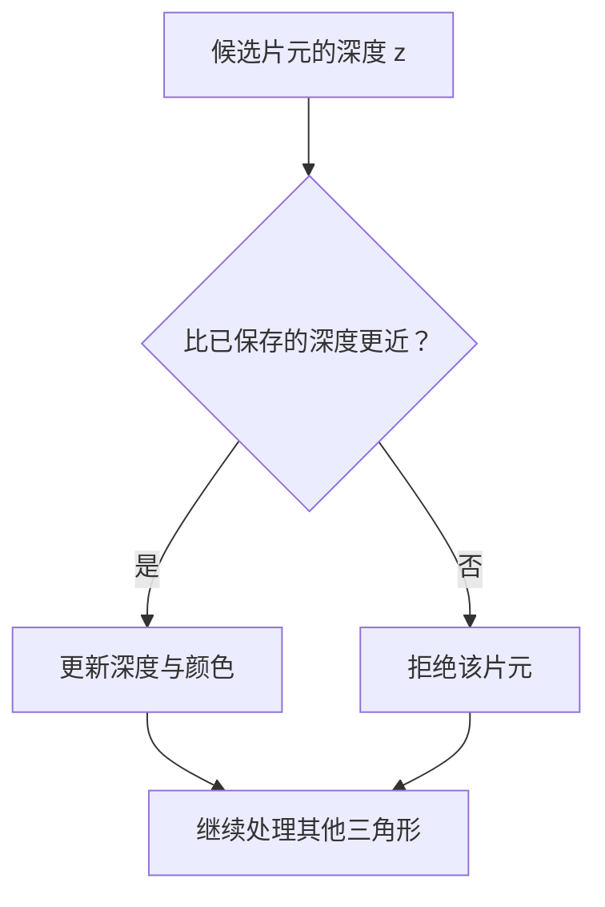
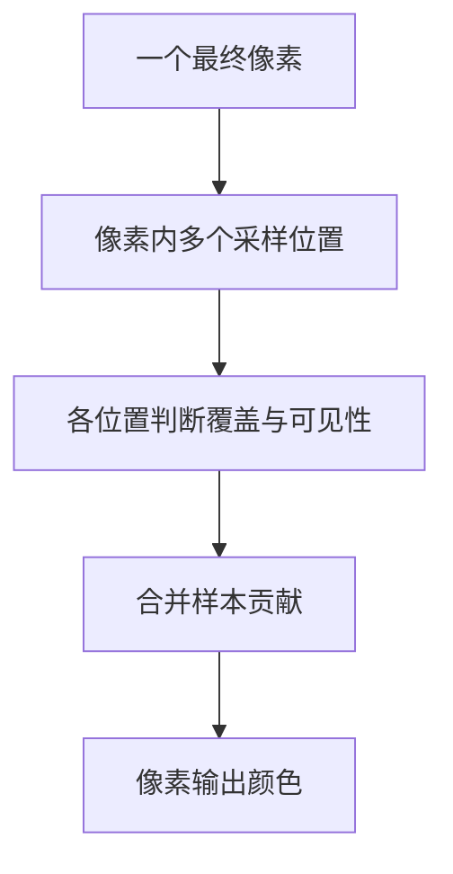

# 光栅化与抗锯齿

变换与投影给出了三角形在屏幕上的位置。屏幕却由离散像素组成，不能直接显示一个连续的三角形。光栅化要把连续的几何覆盖关系转成离散样本，再由着色、深度测试与混合等步骤生成图像。

## 一、三角形覆盖测试

先取三角形在屏幕上的包围盒，只检查这个范围内的采样点。最简单的方案是每个像素取中心点，判断它是否位于三角形内。

对按一致绕序排列的三个顶点，可以用三条边的二维叉积符号判断点在哪一侧。三个结果满足同侧条件，采样点就在三角形内。落在公共边上的点还需要统一的归属规则，例如 top-left 规则，避免相邻三角形重复计入或留下缝隙。

**片元不是最终像素。** 同一个像素位置可能被多个三角形覆盖；一个片元还可能在深度测试时被拒绝，或通过混合只贡献部分颜色。多重采样时，像素内部还会保留多个覆盖与深度样本。

## 二、重心坐标与属性插值

三角形内部的点可以由三个顶点的加权和表示：`p = αA + βB + γC`，其中 `α + β + γ = 1`。三角形内部的三个权重均不小于零。

这组权重可用于插值顶点颜色、法线和纹理坐标。不过，透视投影会改变空间比例，不能把屏幕空间线性插值直接套到所有属性上。

对需要透视正确插值的属性 `q`，使用屏幕重心权重和顶点的裁剪坐标 `w`：

`q = (α qA/wA + β qB/wB + γ qC/wC) / (α/wA + β/wB + γ/wC)`

一块斜向远处延伸的棋盘最能暴露错误：若直接线性插值 UV，纹理会出现不正确的扭曲。深度有自己的投影与插值规则，不要把这个属性公式不加区分地应用到所有量。

## 三、深度缓冲与相机可见性

对不透明表面，深度缓冲在每个样本处保存当前最近表面的深度。下面采用“深度越小越近”的约定：

这张图是理解不透明绘制的简化模型，不是 GPU 执行时序规范。实际硬件可以在满足条件时提前做深度测试，减少不必要的着色工作。

深度缓冲解决的是**当前相机看到哪个表面**。透明物体的颜色可能依赖后方物体，仅留下最近表面就不够，还需要合适的混合与排序策略。

透视深度通常不是世界距离的线性表示。近裁剪面过近、远近范围跨度过大，可能浪费深度精度；几乎共面的两个面也容易产生交替闪烁的深度冲突。

## 四、锯齿是采样问题

一条斜边连续地穿过像素网格。如果每个像素只用中心点决定“全亮或全暗”，边缘就会形成台阶。模型顶点再多，也不能自动解决屏幕采样不足。

更合适的目标是估计一个像素覆盖范围内的平均信号。对于纯色三角形边界，这可以先理解为估计它覆盖了像素面积的多少。

先过滤，再采样，可以减少无法由当前采样密度表达的高频变化。已经发生混叠的图像再做模糊，通常无法恢复被错误折叠的信息。

## 五、超采样与多重采样

**SSAA（超采样）**在一个最终像素范围内取多个样本，对更细的图像进行着色，再合并到目标分辨率。边缘和部分着色变化都能受益，但计算和存储成本较高。

**MSAA（多重采样）**重点增加几何覆盖和深度的采样，通常让同一片元的多个样本共享着色结果。它能以较低成本改善几何边缘，却不能自动解决纹理缩小时的闪烁，也不等于对每个子样本独立执行一次完整着色。

图展示的是多样本成像的共同思路。不同抗锯齿算法对着色频率、样本存储和合并方式的选择并不相同。

## 六、三个对照实验

1. **保持模型不变，提高分辨率。** 边缘台阶变细，说明问题来自屏幕采样，而不一定来自几何面数。
2. **旋转一条细长三角形。** 单点采样下，它可能忽隐忽现；增加样本能改善覆盖估计，但仍有有限分辨率的限制。
3. **观察远处棋盘纹理。** 即使打开 MSAA，纹理内部仍可能闪烁。下一篇的纹理过滤与 mipmap 才是对应的处理手段。

## 参考资料

- [GAMES101 课程大纲](https://sites.cs.ucsb.edu/~lingqi/teaching/games101.html)：三角形离散化、深度测试与抗锯齿；插值在后续着色部分进一步展开。

[上一篇：变换与投影](knowledge/bim/computer-graphics/index.md) · [下一篇：着色与纹理](knowledge/bim/computer-graphics/materials-and-textures.md)
