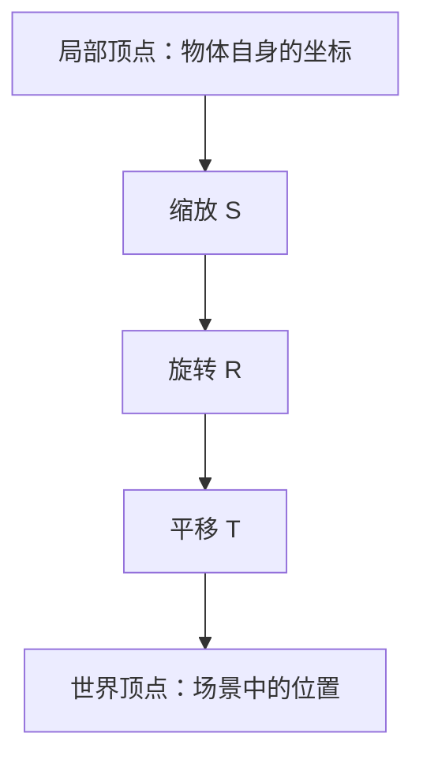
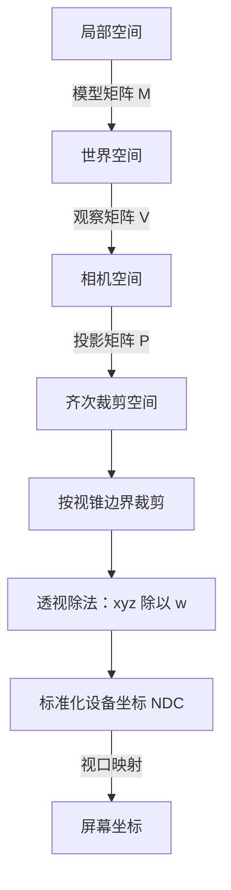

# 02 变换与投影

一个三维顶点要出现在屏幕上，首先要回答三个问题：物体放在哪里，相机从哪里看，以及深度如何影响画面中的大小。模型变换、观察变换和投影变换分别处理这三个问题。

## 一、点、向量与齐次坐标

点表示位置，向量表示方向与长度。把整个物体平移时，点的位置会改变，物体表面的方向却不应跟着平移。

三维坐标后增加一个分量，就能把这种区别放进同一种计算形式：点写成 `(x, y, z, 1)`，方向向量写成 `(x, y, z, 0)`。平移矩阵的最后一列因此只会作用于点。

向量的两个运算会反复出现：

- **点积**衡量方向的一致程度。单位向量点积等于夹角的余弦，可用于计算光照中的朝向关系。
- **叉积**得到垂直于两个输入向量的向量，可用于构造三角形法线和相机坐标系。交换输入顺序，结果方向会反转。

齐次坐标不仅是平移的技巧。透视投影后，第四个分量还会参与除法，把深度转换成画面中的缩放。

## 二、模型变换与运算顺序

几何体通常先定义在自己的局部坐标系中。模型矩阵把这些坐标放进世界空间，包括缩放、旋转和平移。

本文使用列向量约定，矩阵从右向左作用。`M = T × R × S` 表示先缩放，再旋转，最后平移。

拿二维点 `(1, 0)` 做一个具体计算：绕原点逆时针旋转 90°，再沿 x 轴平移 2，结果是 `(2, 1)`；先平移再旋转，结果则是 `(0, 3)`。操作一样，顺序不同，位置就不同。

图中的箭头表示实际计算顺序。旋转中心也属于定义的一部分：绕物体中心旋转，与绕世界原点旋转，会形成完全不同的运动。

## 三、观察变换

相机有位置、观察方向和上方向。观察变换把世界里的点改写到相机坐标系中，使后续投影可以统一地以相机为参照。

如果相机的世界变换为 `C`，观察矩阵就是它的逆矩阵：`V = inverse(C)`。相机向右移动，在相机坐标中静止物体就向左移动。

这里采用常见的右手观察坐标约定：相机朝负 z 方向看，正 y 向上。不同 API 可以使用不同约定；重要的是整条计算链保持一致。

## 四、正交投影与透视投影

**正交投影**把一个长方体观察范围映射到标准范围。保持其他条件不变时，物体不会因为离相机更远而缩小，适合比较尺寸和平行关系。

**透视投影**对应一个视锥。用相机位于原点、成像平面距离为正数 `f` 的简化模型，对位于相机前方的点，有：

`x_image = f × x / (-z)`

`y_image = f × y / (-z)`

例如，`f = 1` 时，点 `(1, 0, -2)` 的横坐标投影为 `0.5`，点 `(1, 0, -4)` 的横坐标投影为 `0.25`。同样的横向距离，在更远处只占更小的画面范围。

完整投影矩阵还要处理宽高比、视野角、近远裁剪面和深度映射。它输出的是四维裁剪坐标，而不是最终像素坐标。

## 五、从裁剪空间到屏幕

顶点的核心变换可以写成 `p_clip = P × V × M × p_local`。裁剪发生在透视除法之前，避免把相机后方或跨越裁剪面的几何直接当成普通屏幕三角形处理。

透视除法得到 NDC 后，视口映射才把标准范围映射到具体画布的宽高。画布是 800×600 还是 1600×1200，不应改变模型在世界中的尺寸。

## 六、宽高比与分辨率

投影和输出尺寸是两个独立设置。

- 宽高比改变时，要更新投影，否则圆可能被拉成椭圆。
- 输出分辨率提高时，参与成像的像素更多，但模型的几何结构没有改变。
- 两个方向的像素数量都翻倍，总像素数变为四倍，后续光栅化和着色的成本也可能显著增长。

用一个立方体分别改变相机距离、视野角和输出分辨率，可以观察三种变化：透视大小变化、画面取景变化、边缘采样精细程度变化。把这三者分开，才能准确定位画面问题。

## 参考资料

- [GAMES101：现代计算机图形学入门](https://sites.cs.ucsb.edu/~lingqi/teaching/games101.html)：向量与线性代数、二维与三维变换、模型与视图投影。本文为独立讲解，章节推进参考课程顺序，不是官方讲义。

[上一篇：BIMer需要的图形学](/knowledge/computer-graphics/01-BIMer需要的图形学) · [下一篇：光栅化与抗锯齿](/knowledge/computer-graphics/03-光栅化与抗锯齿) · [计算机图形学](/knowledge/computer-graphics/index)
