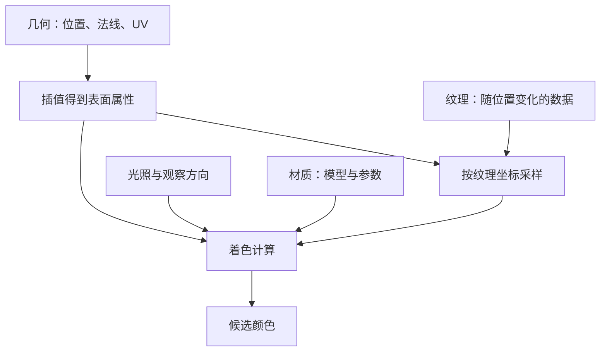
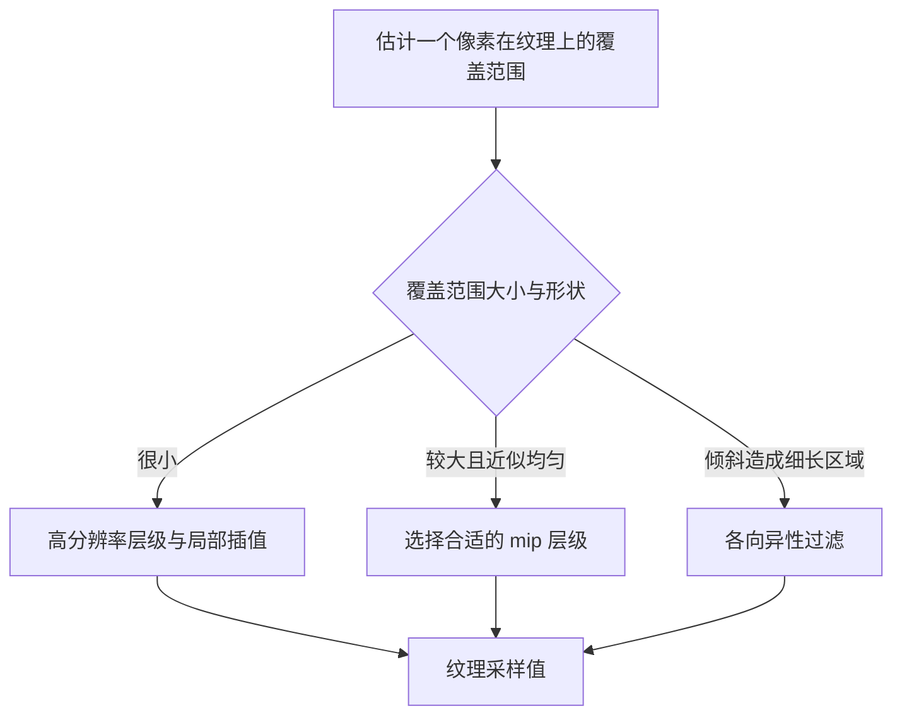

# 05 着色与纹理

光栅化确定了哪些样本被三角形覆盖，着色则计算这些表面位置应当呈现怎样的颜色。它需要表面朝向、光照、观察方向和材质参数；纹理让这些参数随表面位置变化。

## 一、局部光照模型

先看一个表面点。令 `n` 是单位法线，`l` 是指向光源的单位向量，`v` 是指向观察者的单位向量。讨论这些方向时，必须把它们放在同一个坐标空间中。

最基础的漫反射项包含 `max(0, n·l)`：光线越接近垂直入射，单位表面面积接收到的能量越多；背向光源时，将该项截断为零。

对理想点光源，还需要考虑距离平方衰减。固定光强时，距离加倍，照度中的距离因子降到四分之一。方向光使用平行方向近似，通常不套用这一距离模型。

Blinn–Phong 模型用半程向量 `h = normalize(l + v)` 表达高光，其镜面项包含 `max(0, n·h)^p`。指数越大，高光越集中。它是便于计算的经验模型；后续基于物理的反射模型还会进一步约束能量和方向分布。

传统模型中的常量环境项，可以让背光面不至于全黑，但不会自动算出光在墙壁之间的多次反射。

## 二、着色频率与表面法线

同一套光照公式，可以在不同位置计算：

- **逐面着色**：一个三角形使用统一的表面信息，棱角明显。
- **逐顶点着色**：在顶点计算颜色，再在三角形内插值；小范围高光可能落在顶点之间而被漏掉。
- **逐片元着色**：插值法线等属性，在片元处计算光照；插值后的法线通常需要重新归一化。

这里的 Phong shading 指逐片元插值法线后着色；Phong reflection model 指一种反射模型。相近的名字不代表同一个概念。

纹理提供数值，材质说明数值的含义和用法，着色器执行具体计算。没有纹理也可以着色，例如用统一的基础颜色和粗糙度表现一个纯色球体。

## 三、UV 与纹理采样

UV 是表面对应的二维纹理坐标。三角形顶点携带 UV，光栅化时插值得到片元位置的 UV，再到纹理中取数据。透视观察下，需要使用透视正确插值。

纹理中的离散单元叫纹素，屏幕上的离散位置叫像素。它们没有一一对应关系：一个远处像素可能覆盖大量纹素；近距离看时，一个纹素又可能覆盖多个像素。

**最近邻采样**取邻近的单个纹素，容易看到块状变化。**双线性过滤**在同一层级的四个相邻纹素之间插值，能平滑放大时的过渡，却无法靠四个纹素代表缩小时可能覆盖的大片区域。

## 四、Mipmap 与各向异性过滤

Mipmap 预先生成逐级缩小、经过过滤的纹理。像素覆盖范围越大，就选择越低分辨率的层级。三线性过滤还会在相邻两个 mip 层级的双线性结果之间插值，减少层级切换的突变。

图中是选择策略的概念划分，不是三种互斥的硬件模式。各向异性过滤也可以结合 mipmap 使用。

纹理缩小产生的摩尔纹与三角形边缘锯齿来自不同的采样环节。Mipmap 不能修复错误 UV，也不能替代几何边缘的抗锯齿。

## 五、贴图的数据含义

| 纹理输入 | 参与的计算 | 是否直接改变几何形状 |
|---|---|---|
| 基础颜色 | 表面反射颜色等参数 | 否 |
| 粗糙度、金属度 | 反射分布与材质行为 | 否 |
| 法线贴图 | 扰动着色法线 | 否 |
| 凹凸贴图 | 根据高度变化估计法线扰动 | 否 |
| 位移贴图 | 依据高度移动表面位置 | 是 |
| 环境遮蔽 AO | 近似局部环境光遮挡 | 否 |
| 透明度贴图 | 透明混合或覆盖裁剪 | 否 |

法线与凹凸贴图主要改变明暗，原来的几何轮廓通常不变。位移可以改变轮廓和阴影，但若实现只移动已有顶点，就必须有足够的网格密度；四个顶点的平面不能凭一张高度图生成密集山峰。

同一张灰度图用作粗糙度或高度时，视觉结果完全不同。图像只是数值容器，接入哪个计算输入决定了它的含义。

颜色纹理通常需要从 sRGB 解码到线性空间后参与光照计算。法线、粗糙度、金属度等数据纹理则应按各自数值语义读取，不能一律套用颜色解码。

## 六、环境映射

环境映射保存周围不同方向的信息，常见表示有立方体贴图和经纬度展开图。查询它时，坐标通常来自方向，例如反射方向，而非普通的表面 UV。

显示环境背景与利用环境参与照明是两件不同的事。背景可以只负责画面远处的显示；环境照明还需要根据材质反射分布，对来自不同方向的光进行积分或近似预过滤。

HDR 表示更大的亮度动态范围，不是一种自动产生真实光照的算法。AO 也只是有限的遮蔽近似，不能代替随灯光移动的投影阴影或完整的间接照明。

## 七、用对照观察定位变化

1. 保持几何和灯光不变，只改粗糙度，观察高光的分布。
2. 给平面分别添加法线贴图和位移，从侧面检查轮廓。
3. 将棋盘纹理逐渐移远，比较最近邻、双线性和 mipmap 的缩小效果。
4. 只改变纹理颜色，观察灯光与表面朝向仍然怎样影响最终明暗。

## 参考资料

- [GAMES101 课程大纲](https://sites.cs.ucsb.edu/~lingqi/teaching/games101.html)：基础着色模型、着色频率、纹理映射与高级纹理映射。粗糙度和金属度在此仅用于区分参数含义，不展开后续的完整材质理论。

[上一篇：几何表示与曲面](/knowledge/computer-graphics/04-几何表示与曲面) · [下一篇：可见性与阴影](/knowledge/computer-graphics/06-可见性与阴影) · [计算机图形学](/knowledge/computer-graphics/index)
