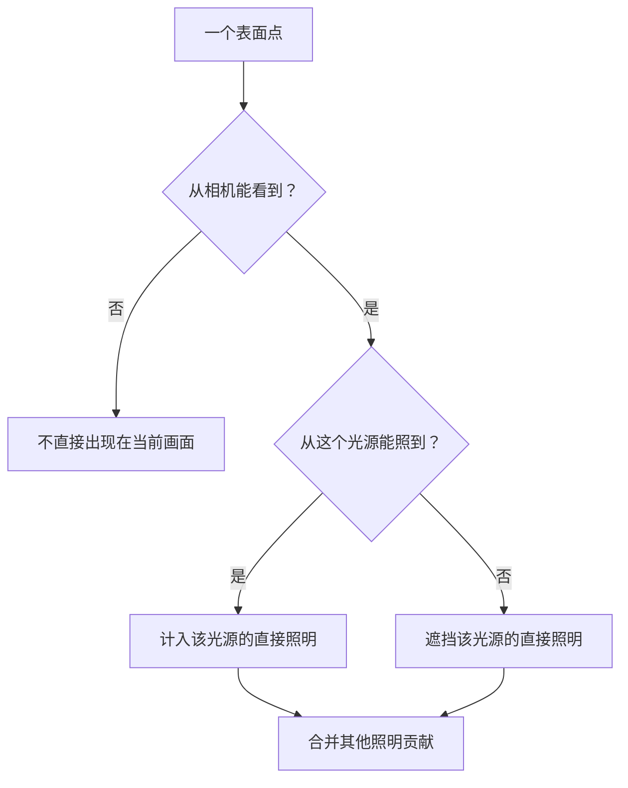
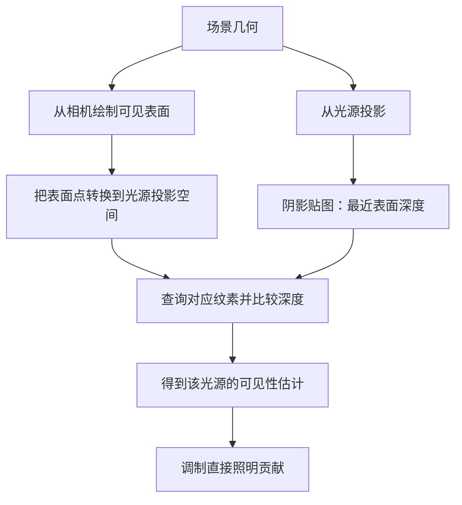
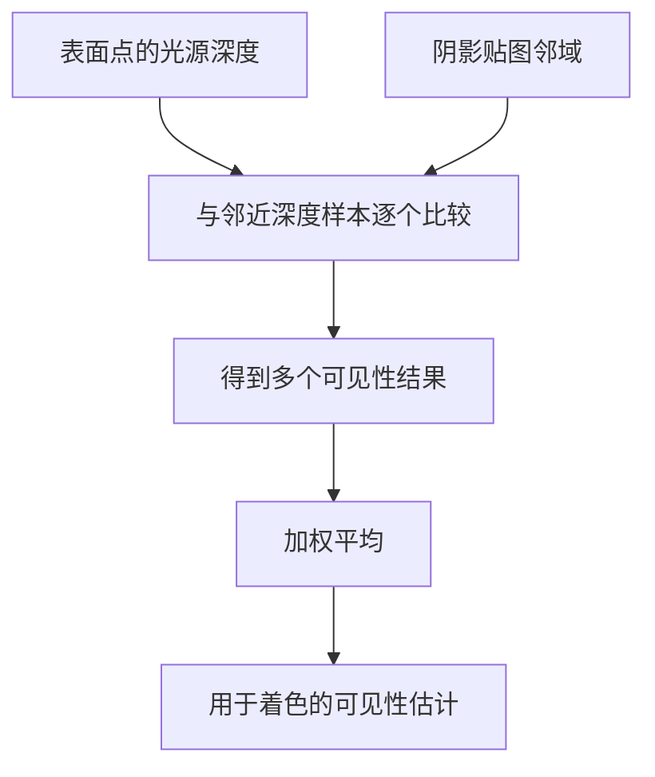

# 06 可见性与阴影

表面朝向光源，不代表光线一定能够到达它。局部着色模型计算表面对光的响应，阴影计算补充光源与表面之间的遮挡关系。

## 一、相机可见性与光源可见性

相机深度缓冲回答“当前视线最先遇到哪个表面”。阴影则要从光源出发，再问一次“光到达这个点之前，有没有先遇到别的表面”。

用简化形式表示，一盏灯对表面的直接照明贡献为：

`直接照明 = 光源可见性 × 不考虑遮挡时的照明贡献`

对理想点光源和不透明遮挡物，可见性可以先视为 0 或 1。面光源的不同部分可能有不同遮挡情况，因此会形成半影。处于阴影中的点也不一定全黑，它仍可能接收其他光源或间接光。

这张图只讨论直接可见表面的基本着色。反射、折射和间接光还可能受到相机看不到的物体影响。

## 二、阴影映射的两次观察

Shadow Map 把光源可见性转化为深度比较。以方向光为例：

**第一遍，从光源观察场景。** 用对应的光源投影记录最近表面的深度，得到阴影贴图。它存储的是深度信息，不是一张黑色影子的照片。

**第二遍，从相机绘制画面。** 把待着色的表面点转换到同一光源投影空间，查询阴影贴图中的最近深度，再比较当前点的深度。

若当前点比光源记录的最近表面更远，就说明光在途中遇到了遮挡。两边的深度必须使用一致的空间与编码，不能拿世界距离直接与经过投影的深度值比较。

## 三、光源类型与投影范围

方向光近似平行光线，常使用正交投影记录遮挡。聚光灯具有光锥，常使用透视投影。点光源向多个方向发光，常用立方体贴图的六个方向记录距离或深度，具体编码依实现而定。

每个光源的遮挡关系都可能不同，因此不能把一盏灯的阴影图直接当作另一盏灯的结果。环境照明来自多个方向，也不能仅靠一张普通的方向光阴影图完整表示。

阴影投影还必须覆盖需要计算的区域。位于覆盖范围之外的表面，没有可靠的查询信息；盲目提高纹理分辨率无法修复这一问题。

## 四、分辨率、偏移与常见伪影

固定大小的阴影贴图覆盖的世界范围越大，每个纹素代表的区域越大，边缘和细小遮挡就越难表达。

深度离散与数值误差还可能使表面误判自己为遮挡物，产生条纹或斑点，常称为 shadow acne。适当的深度偏移可以缓解它；偏移过大，又会使阴影与物体脱离，形成 peter-panning。

一个有用的排查顺序是：

1. 检查光源投影覆盖范围与近远裁剪面。
2. 把有限的分辨率集中到需要阴影的区域。
3. 在性能允许范围内增加贴图分辨率。
4. 小幅调整偏移，同时观察自遮挡与阴影脱离。
5. 再检查过滤与更新策略。

## 五、过滤与软阴影

PCF（百分比渐近过滤）在邻近位置分别进行深度比较，再平均比较结果，使阴影边缘的过渡更平滑。

这里平均的是“是否可见”的结果。先平均深度再只比较一次，与平均多次可见性判断不是一回事。

过滤能减轻离散边缘，但固定范围的 PCF 并不等价于真实面光源的软阴影。真实半影的宽度还与光源大小、遮挡物及接收面的距离关系有关。

## 六、实时阴影、烘焙与人工假阴影

| 方法 | 信息来源 | 场景改变后的处理 |
|---|---|---|
| 实时阴影映射 | 从光源投影计算遮挡 | 相关几何或光源改变后需要更新 |
| 烘焙光照或阴影 | 预先计算并存储结果 | 静态结果通常需要重新烘焙 |
| 人工假阴影 | 绘制的暗色图案 | 位置、大小与形状需要另行控制 |

一个带透明度的暗色平面，可以低成本提供接触感，但它本身没有光源遮挡推导。移动灯光或抬高物体，它不会自动产生正确变化。

“用纹理显示”只描述显示方式，不能判断是否属于烘焙。纹理既可能来自预计算照明，也可能只是人工绘制的渐变圆。

## 七、阴影与全局光照的边界

直接与间接描述光经过的路径；漫反射与镜面反射描述表面的反射行为。这两组分类不在同一层。

- **直接照明**：光源直接到达表面。
- **间接照明**：光先经其他表面反射，再到达这里。
- **全局光照**：考虑场景中光的传播与表面之间的相互影响。

阴影映射主要补充直接光的遮挡，并不会自动计算彩色墙壁反射出的间接光。常量环境项也只能做粗略补偿。更完整的光线传播需要引入光线追踪、辐射度量学和渲染方程等内容。

## 八、对照实验

保持球体、平面和灯光不变，先只计算局部光照，再加入阴影可见性。球本来已有明暗，平面上的投影阴影则由新增的遮挡信息产生。

随后分别移动光源、扩大阴影投影范围、改变偏移，观察阴影位置、细节与表面接触关系。每次只改变一个参数，更容易分清几何关系、离散精度和数值误差。

## 参考资料

- [GAMES101 课程大纲](https://sites.cs.ucsb.edu/~lingqi/teaching/games101.html)：阴影图安排在几何与网格处理之后，后续进入光线追踪和全局光照。本文中的 PCF 与实现问题作为阴影映射的补充说明。

[上一篇：着色与纹理](/knowledge/computer-graphics/05-着色与纹理) · [计算机图形学](/knowledge/computer-graphics/index)
