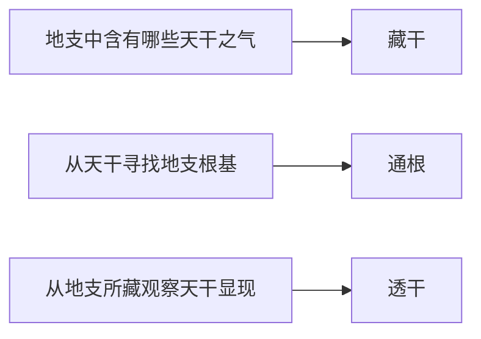

# 论十干十二支

> 《子平真诠》学习笔记 · 第 01 篇。按本系列所用通行篇序排列，不同版本编号可能不同，以篇名为准。正文为概述与推演，不作为古籍原文或评注引文。

本系列从符号、关系与力量逐步进入月令格局。命理预测缺乏可靠的现代科学验证；这里讨论传统文献的概念与内部推演，不应用于医疗、投资、婚姻等重大决策。文中例子仅保留教学所需的局部关系，不能据此判断完整命局。

## 天干与地支

甲乙木、丙丁火、戊己土、庚辛金、壬癸水；甲丙戊庚壬为阳，乙丁己辛癸为阴。日干作为十神判断的参照。地支可藏不同天干之气，寅藏甲丙戊是反复使用的例子。

## 藏干、通根与透干

藏干回答“支中有哪些气”；通根从天干看地支根基；透干从地支看所藏之气是否出现在天干。不能把透干限定在年干，也不能把天干出现等同于有力。

## 自测

甲天干见寅，寅中有甲，是什么？答：通根。寅藏丙而天干见丙，是什么？答：透干。两者观察方向不同。

本篇是基础知识整理，不作逐段原文训释。

---

[下一篇：论阴阳生克](/knowledge/traditional/ziping/yin-yang-and-ten-gods) · [传统文化](/knowledge/traditional/index)
