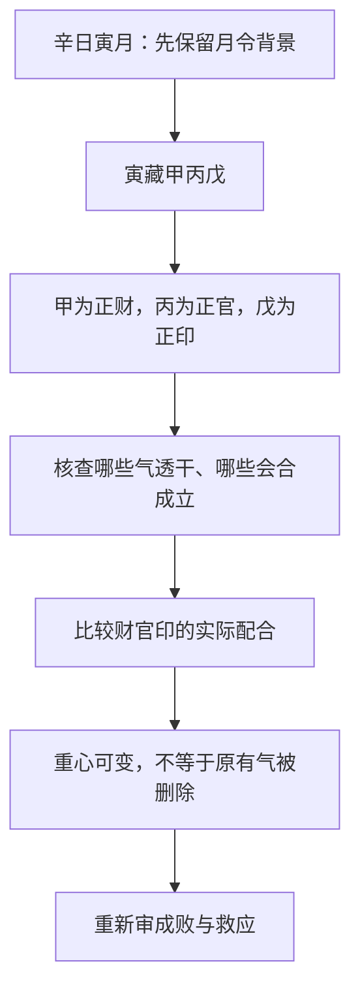

# 论用神变化

> 《子平真诠》学习笔记 · 第 10 篇。按本系列所用通行篇序排列，不同版本编号可能不同，以篇名为准。正文为概述与推演，不作为古籍原文或评注引文。

本文讨论传统术数的内部规则，不代表经过科学验证的人生预测。局部例子只用于辨析概念。

月令藏气不一，透干与会合可改变格局主次。变化不意味着原来的气被删掉。

学习例：辛日寅月，甲正财、丙正官，寅藏甲丙戊。透干不同会影响取用重心；甲丙并透可讨论财格兼官，不能把“变化”理解成推翻所有本格。

变化可分为变而善、变而不善、变而不失本格。善不善指是否有利于该体系中的配合，不是官永远好杀永远坏。
## 自测

透出一个干就自动改格吗？答：不能。需把月令、透干、会合和实际配合连起来。

## “变化”改变的是取用重心

前篇讨论一个结构如何成败，本篇再问：最初从月令识别的线索，会不会因透干和会合而出现不同的组织方式？月令并不总能压缩成一个单独天干。比如寅藏甲、丙、戊，藏气之间本就有不同的十神关系。实际透出什么、怎样配合，会影响哪一条关系成为分析中心。

这里的“变”不是把月支换掉，也不是把原本未透出的藏气视为不存在。更不能理解为看到命局有某个天干，就随意把月令格局改名。先保留月令背景，再说明新出现的关系如何改变主次，才是可复核的推演。

## 一例三读：辛日寅月

这个例子只保留教学所需的日主与月令，不对应任何人的完整四柱。辛为阴金，寅中甲木对辛是正财，丙火对辛是正官，戊土对辛是正印。先把这三项算清，后面的讨论才不会把不同参照混在一起。

| 局部观察 | 可以提出的分析线索 | 仍不能省去的检查 |
| --- | --- | --- |
| 重点观察甲透 | 财的作用在天干显现 | 财是否有力、日主能否承接、是否受劫 |
| 重点观察丙透 | 官的作用在天干显现 | 官是否受伤、财官印如何配合 |
| 甲丙并透 | 可讨论财与官协同、财格兼官 | 财生官是否合宜，丙辛合等关系是否影响作用 |

这里列的是三种观察条件，而不是三份可以直接定格断事的完整命局。尤其丙与辛有五合配对，不能一面强调条件分析，一面在此处又忽略日主自身参与合的情形。是否受牵、怎样理解本身之合，需要回接第五篇，不能因为看到“财生官”便宣布全部问题消失。

## 三个“变”的说法如何区分

**变而善**：变化后的配合，更能承担该体系下所需的任务。所谓善是结构上的相宜，不是某个十神名称自带好结局。比如新显现的关系能够衔接已有作用，而没有破坏关键环节，才有继续讨论的依据。

**变而不善**：新增或转强的关系妨碍原有配合，或者使原先次要的问题成为主要矛盾。不能把它机械简化为“透杀就是不善”；七杀若得适当制化，仍需按实际条件重判。

**变而不失本格**：取用的具体配合发生变化，但原来的月令线索仍发挥作用。辛日寅月甲丙并透，可以从财官关系讨论兼用，不必把财的线索整段删去。这个说法提醒我们，变化与连续性可以并存。

这三个表述是分析结果，不是起步时直接套用的标签。要先展示推理链，再使用术语。只写“此为变而善”，却没有说明什么变了、原格保留什么、受益的是哪一环，读者仍然无法检验。

## 和前后章节如何接上

与第八篇相比，本篇不是否定月令取用，而是展开月令藏气与实际配合之间的关系。与第九篇相比，成败救应评估某条路径是否成立，变化讨论这条路径为何成为当前的取用重心。与第十一篇相比，变化回答“主次如何调整”，纯杂回答“调整后的几种作用能否相得”。三个问题相关，但不能用一个词替代另外两个。

## 推演练习与答案

1. 辛日寅月，只知道甲丙并透，能否断言财官一定相得？不能。财官生克方向已经明确，但丙辛合、强弱、位置和其他干支的干扰尚未交代。
2. 某藏干没有透出，是不是已经不存在？不是。未透只表示没有以对应天干的形式显现，不等于没有根气与支中作用。
3. 取用重心变化后，是否可以跳过成败救应？不能。新的组织方式仍可能带忌，也仍须检验救应。
4. 本篇是否在说人生会在某年“变格”？不是。本文讨论静态结构的辨析，没有提供大运流年资料，也没有据此推演现实事件。

---

[上一篇：论用神成败救应](/knowledge/traditional/ziping/formation-failure-and-rescue) · [下一篇：论用神纯杂](/knowledge/traditional/ziping/purity-and-mixture) · [传统文化](/knowledge/traditional/index)
