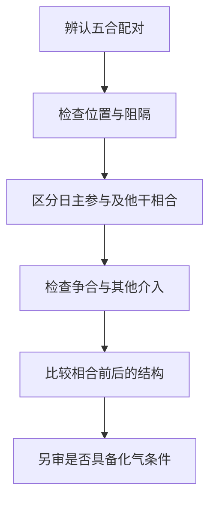

# 论十干合而不合

> 《子平真诠》学习笔记 · 第 05 篇。按本系列所用通行篇序排列，不同版本编号可能不同，以篇名为准。正文为概述与推演，不作为古籍原文或评注引文。

本文讨论传统术数的内部规则，不代表经过科学验证的人生预测，不宜用于医疗、投资、婚姻等重大决策。局部例子只用于辨析概念，不含个人四柱。

## 本篇先解决什么问题

认识甲己、乙庚、丙辛、丁壬、戊癸五组配对，只完成了辨认符号。实际阅读命例时，还要问：这两个干是否能够发生所讨论的作用？作用落在谁身上？原来的结构因此得到保护，还是失去支撑？本篇的重点，就是把配对、相合的作用与化气分成不同层次，避免看见两个字便跳到结论。

例如丙辛属于五合配对，这是规则层面的判断；丙辛在某一组合中是否相合有力，则要看位置、阻隔及其他干的介入；是否进一步按化水讨论，又是条件更严格的问题。前一步成立，不替后一步提供自动保证。本文不以简化口诀补齐尚未核实的化气条件，也不把没有化气误读成完全没有合的影响。

## 按顺序检查，先不急着说好坏

先辨配对，再辨位置。位置较近，通常更容易直接讨论相互作用；相隔较远或中间有其他作用介入，则须解释关系怎样落实。这里没有一条适用于所有组合的距离算式，不能只凭柱位就宣布某干消失。

接着区分日主自身参与的合与其他天干之间的合。课程中关于本身之合不作合去的思路，提醒我们：日主与某十神发生相合，不能照搬第三者把这个十神合走的说法。仍要解释这种关系怎样改变日主与财、官等对象的配合，不能把自身之合理解成永远无害或必定有利。

再看有没有争合、妒合等复杂情况。出现两个同类天干争取一个对象，只能说明关系需要重新分析，并不等于两边平均分配，也不能机械地说多出来的一个必然留下。所谓合一留一，必须交代谁被牵制、谁仍能发挥作用，以及留下者是否正是结构所需。

## 局部例一：同是合官，前提不同

设教学片段以甲为日主，辛为正官，且只讨论一位辛官承担关键作用的情况。另有丙与辛相合，如果相合确实牵制了辛，原先依赖辛的配合就可能受影响。这里必须保留两个前提：辛原本是所需对象，丙辛的作用能够落实。只凭丙辛两个字，尚不能写成官已失用。

另设一个不同片段，原先有重复或混杂的对象，而一位受到牵制后，另一位合宜对象仍能发挥作用。这时才有讨论合一留一、结构变清的空间。它不能反过来证明前一例合官也一定好，因为两例原本要解决的问题不同。一例可能损失唯一支撑，另一例可能减少干扰。

## 局部例二：先说清楚到底合了谁

仍以甲为日主，辛官受到丁伤官克制，壬与丁有五合关系。若壬丁合有效牵制丁，可以讨论辛是否得到间接保护。直接被合的是丁，不是辛；壬相对甲仍是偏印，丁仍是伤官，不能因二者发生相合而随意改换十神名称。

这个片段只展示一条可能的保护链，不证明全局成立。还要检查丁是否确被牵制、辛自身能否任用，以及壬在别处有什么作用。把合解释成删除键，就会漏掉这些后续问题。

## 反例：不能把作用当作算术扣分

有人把一个干先受克、又被合，写成力量连续扣掉两次，最后等于零。这种推法混淆了力量与作用状态。相合可能改变它对其他对象的作用方式，却不必然抹除其五行属性、根气与所有关系。判断应回到具体路径，而不是给每次合克设一个固定分数。

## 自测与答案

1. 有五合配对、有效相合、合化成功，是同一件事吗？答：不是，分别是配对资格、作用能否落实、是否满足进一步化气的条件。
2. 唯一所需辛官被丙牵制，与混杂中合一留一，能用同一句吉凶结论吗？答：不能，原来的结构与留下的对象不同。
3. 壬丁合可能保护辛官，能说辛被壬合住了吗？答：不能，直接相合的是壬丁，护辛是可能的间接结果。

---

[上一篇：论十干配合性情](/knowledge/traditional/ziping/heavenly-stem-combinations) · [下一篇：论十干得时不旺失时不弱](/knowledge/traditional/ziping/season-roots-and-strength) · [传统文化](/knowledge/traditional/index)
