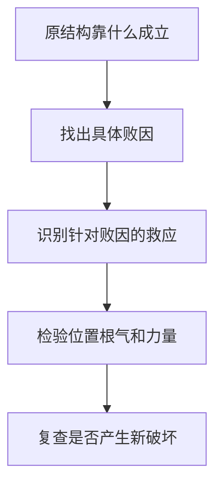

# 论用神成败救应

> 《子平真诠》学习笔记 · 第 09 篇。按本系列所用通行篇序排列，不同版本编号可能不同，以篇名为准。正文为概述与推演，不作为古籍原文或评注引文。

本文讨论传统术数的内部规则，不代表经过科学验证的人生预测。局部例子只用于辨析概念。

核心四问：原先靠什么成格？什么破坏它？谁处理破坏？这种处理是否真正有效？成格、败格、带忌、救应是不同层次。

### 官格与建禄用官

甲日酉月以辛官为核心，丁伤官克辛；壬印合丁，可能护官。与甲日寅月建禄用辛官有相同生克链，但月令格局归属不同。丙日巳月的迁移练习：癸为正官，己为伤官，甲为偏印；甲己合可能护癸，但甲也生丙，不能断定全局只有好处。

### 财逢劫

可以用食伤引化比劫并生财，或官星制劫护财。两条救法作用机制不同，不能背成“见某吉神必救”。

### 印逢财

印轻受财破坏时，劫财制财或合财可能存印；印过旺而需要财制印时，劫财夺财反可能损坏配合。同一财星克印既可能是败因，也可能是成格手段。

### 食神逢枭

这里分清两条路径：生财以制枭护食，保留食神的成格路径；弃食就杀则改变取用配合，不能说两者都只是增加同一个吉神。这里只概述这一取用思路，不把“弃食就杀”扩展成任意换格规则。

### 杀逢食制、印来护杀

当食神正承担制杀功能，印制食可能破坏这一功能；有财制印、存食时可讨论救应。反过来，阳刃需要官杀制刃时，食伤制官杀可能变成破坏，印制食伤反而可能护官杀。关键是先认出要维护的结构。

### 伤官生财与财生杀

财可承接伤官，但财又生杀，可能造成新问题；伤官本身也能制杀，不能直接说“有财生杀就七杀无制”。看双方力量与作用是否落实。

### 建禄用财、带杀而杀被合

甲日寅月，己正财、庚七杀、乙劫财。己生庚，庚克甲；乙庚合若有效牵制庚，可讨论救应，但乙也克己，不能只看合杀忽略夺财。

建禄不等于自动成格，用财仍须处理比劫夺财与食伤生财的条件。甲生丙、丙生己，是泄身生财；丙克庚是食神制杀，两条机制不能混为一谈。

### 印格的四种配合

四种配合路径：印轻逢杀（仍须结合身强弱及杀印力量判断）；官印双全；身印两旺用食伤泄气；印多逢财且力量配合合宜。不能一律“印越旺越好”。

关键疑问：印重时为何透官和透杀的判断不同？可旁参后篇《论印绶》解释：正官不只生印，也有自身取用功能；七杀重在制化。身强印重透杀不等于永远不可用，若兼有力食伤制杀、泄身，须重判。

教学例：丁日、乙印、癸杀、己食神。己既泄丁，又克癸。不能说癸生乙后就不再克丁，生克关系可并存。

成中带忌：杀生印原可配合，财再来既克印又生杀，可能破坏原有承接链。救应反过来针对败因，而不是额外堆吉神。

## 小结

有救应关系不等于有效救应；有效保护一环也不保证整个命局成立。力量、位置、根气与合化条件仍需审查。

---

[上一篇：论用神](/knowledge/traditional/ziping/month-command-and-useful-god) · [下一篇：论用神变化](/knowledge/traditional/ziping/changes-of-useful-god) · [传统文化](/knowledge/traditional/index)
