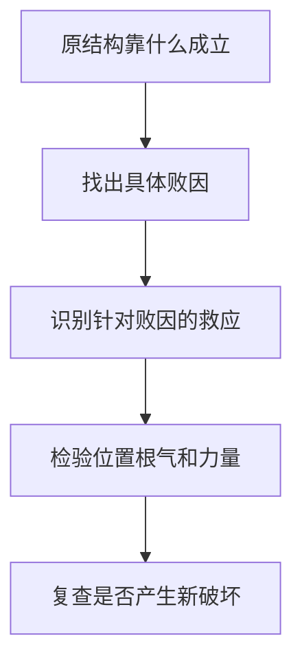
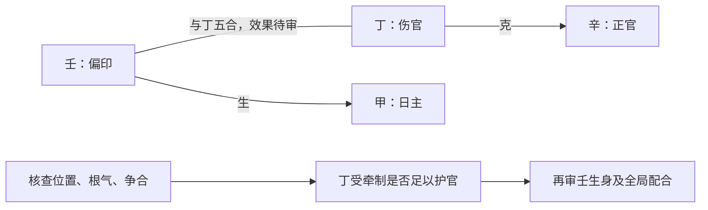
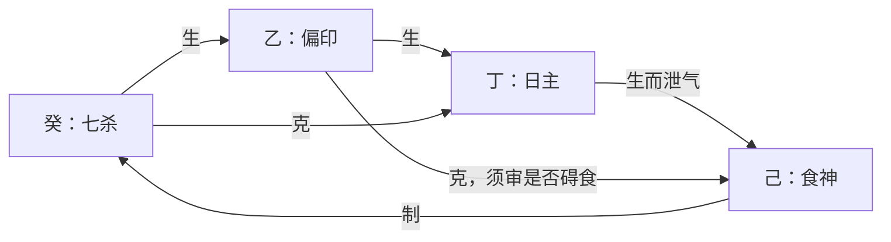

# 论用神成败救应

> 《子平真诠》学习笔记 · 第 09 篇。按本系列所用通行篇序排列，不同版本编号可能不同，以篇名为准。正文为概述与推演，不作为古籍原文或评注引文。

本文讨论传统术数的内部规则，不代表经过科学验证的人生预测。局部例子只用于辨析概念。

核心四问：原先靠什么成格？什么破坏它？谁处理破坏？这种处理是否真正有效？成格、败格、带忌、救应是不同层次。

### 官格与建禄用官

甲日酉月以辛官为核心，丁伤官克辛；壬印合丁，可能护官。与甲日寅月建禄用辛官有相同生克链，但月令格局归属不同。丙日巳月的迁移练习：癸为正官，己为伤官，甲为偏印；甲己合可能护癸，但甲也生丙，不能断定全局只有好处。
### 财逢劫

可以用食伤引化比劫并生财，或官星制劫护财。两条救法作用机制不同，不能背成“见某吉神必救”。
### 印逢财

印轻受财破坏时，劫财制财或合财可能存印；印过旺而需要财制印时，劫财夺财反可能损坏配合。同一财星克印既可能是败因，也可能是成格手段。
### 食神逢枭

这里分清两条路径：生财以制枭护食，保留食神的成格路径；弃食就杀则改变取用配合，不能说两者都只是增加同一个吉神。这里只概述这一取用思路，不把“弃食就杀”扩展成任意换格规则。
### 杀逢食制、印来护杀

当食神正承担制杀功能，印制食可能破坏这一功能；有财制印、存食时可讨论救应。反过来，阳刃需要官杀制刃时，食伤制官杀可能变成破坏，印制食伤反而可能护官杀。关键是先认出要维护的结构。
### 伤官生财与财生杀

财可承接伤官，但财又生杀，可能造成新问题；伤官本身也能制杀，不能直接说“有财生杀就七杀无制”。看双方力量与作用是否落实。
### 建禄用财、带杀而杀被合

甲日寅月，己正财、庚七杀、乙劫财。己生庚，庚克甲；乙庚合若有效牵制庚，可讨论救应，但乙也克己，不能只看合杀忽略夺财。

建禄不等于自动成格，用财仍须处理比劫夺财与食伤生财的条件。甲生丙、丙生己，是泄身生财；丙克庚是食神制杀，两条机制不能混为一谈。
### 印格的四种配合

四种已整理路径：印轻逢杀；官印双全；身印两旺用食伤泄气；印多逢财且力量配合合宜。不能一律“印越旺越好”。

关键疑问：印重时为何透官和透杀的判断不同？可旁参后篇《论印绶》解释：正官不只生印，也有自身取用功能；七杀重在制化。身强印重透杀不等于永远不可用，若兼有力食伤制杀、泄身，须重判。

教学例：丁日、乙印、癸杀、己食神。己既泄丁，又克癸。不能说癸生乙后就不再克丁，生克关系可并存。

成中带忌：杀生印原可配合，财再来既克印又生杀，可能破坏原有承接链。救应反过来针对败因，而不是额外堆吉神。
## 小结

有救应关系不等于有效救应；有效保护一环也不保证整个命局成立。力量、位置、根气与合化条件仍需审查。

## 先把四个判断层次拆开

“成”不是给某个十神贴上吉的标签，而是说明一组配合为何能承担本来的取用任务。“败”则必须指出具体哪一条关系遭到破坏。若只说“有伤官所以败”，还没有回答伤官损害了谁、被损害者是否正是关键环节。所谓成中带忌，是已经看见可成立的路径，又发现牵制它的因素；不能因为有一条好关系，就不再检查其他部分。

救应也有两个层次。第一层是逻辑上有针对性，例如伤官损官而有人牵制伤官；第二层是这种牵制在全局中是否能发挥作用。后一层要回到位置、根气、强弱与争合等条件。本文的箭头只表示待检验的作用关系，不表示已经完成吉凶判断，更不对应现实中的必然事件。

## 把“印来护官”画成作用链

以匿名局部配置“甲日、酉月，另见辛、丁、壬”为例，先分别确定辛是正官、丁是伤官、壬是偏印。不能把壬误写成正印，也不能因为讨论丁壬合而把日主参照换成丁。

读图的顺序是：先认出官受到的损害，再看丁壬合是否能牵制丁，最后检查壬自身引入的其他作用。壬没有直接“合住辛”，图中也不需要先宣布丁壬已经化木。合与化是两道不同的判断。如果丁壬虽有配对而实际作用受阻，只能记为“有潜在救应”，不能写“官已救成”。

换成甲日寅月而仍用辛官，部分作用链可以沿用，但格局背景改为建禄用官。这个对照说明：生克机制可以迁移，格名不能连同答案机械搬运。

## 同一个财，为什么一处救、一处破

比较两种互不混用的前提。情形甲：印本来偏轻，正负责承接官杀或生身，财来克印又生杀，原来的承接链可能受损。情形乙：身印两旺，正需要适量财来约束过重的印，财反而是配合的一环。两者表面上都是“财克印”，结论却不能相同。

因此遇到劫财制财，也不能马上喊“存印得救”。在情形甲，牵制财可能保护所需的印；在情形乙，它可能拿掉原本需要的制约。必须先写清初始条件，才有资格讨论救应。即使在情形甲，劫财本身也可能干扰其他财星作用，需要继续复核。

## 印格补充例：一条干同时有两种作用

丁日见乙、癸、己，乙为偏印，癸为七杀，己为食神。癸水既可生乙木，也可克丁火；己土既承接丁火之生，也能制癸水。这不是说每条关系都能同等强度发挥，而是说不能凭“癸生乙”便把“癸克丁”从图上删除。

如果讨论身强印重而兼食神制杀，己的泄身与制杀是两种作用；但乙克己也不能忽略。这个例子只能帮助列出待审关系，没有完整位置与根气，不能据图断定一定成格。旁参后篇《论印绶》用于理解本章疑点，并不表示后篇已经逐章学习完毕。

## 练习：先指出所缺条件，再回答

1. “看见壬丁合，所以辛官必得救。”缺了什么？答：缺相合能否落实、丁的作用受牵制程度，以及原局是否确实需要保护辛。配对资格不是有效救应。
2. “用食神制杀，印来总是好事。”哪里错？答：印也可能制食而破坏既有制杀路径。应先确认印在本局承担什么任务。
3. “乙庚合救了建禄用财中的杀，所以乙没有坏作用。”哪里错？答：乙对甲仍是劫财，还须检查其克己财的影响。处理一处败因不等于整体无害。
4. “财生杀，七杀就一定无制。”能否成立？答：不能。还要检查食伤是否仍能制杀、印能否承接，以及各环节是否有力。不能从一条新关系直接跳到全局结论。

---

[上一篇：论用神](/knowledge/traditional/ziping/month-command-and-useful-god) · [下一篇：论用神变化](/knowledge/traditional/ziping/changes-of-useful-god) · [传统文化](/knowledge/traditional/index)
