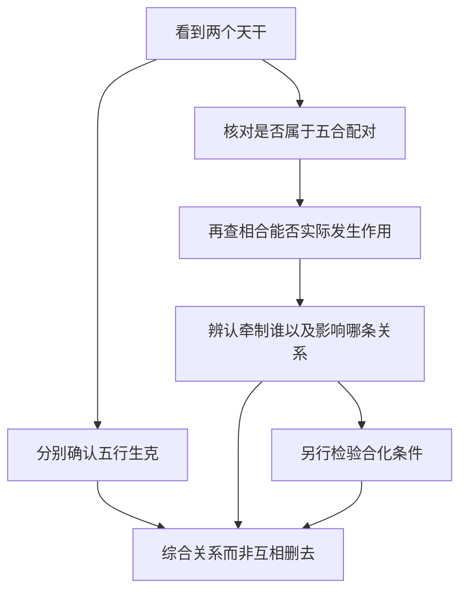

# 论十干配合性情

> 《子平真诠》学习笔记 · 第 04 篇。按本系列所用通行篇序排列，不同版本编号可能不同，以篇名为准。正文为概述与推演，不作为古籍原文或评注引文。

本文讨论传统术数的内部规则，不代表经过科学验证的人生预测。局部例子只用于辨析概念。

## 先记五合，再问合怎样起作用

天干五合的固定配对为甲己、乙庚、丙辛、丁壬、戊癸。传统分别配土、金、水、木、火。初学时可把这两组知识并列记住，但不能把“配化某行”写成“只要两干出现，就已变成某行”。配对、相合的实际作用、合化，是需要分开核查的层次。

本篇先建立这种区分，至于位置、阻隔、争合等成立条件，留到下一篇集中分析。这样的安排不是省略条件，而是先认识问题，再逐项检验。看到配对时可以标注“存在五合关系”，不应立即把原有五行和十神全部删掉。

## 生克与五合为什么可以同时讨论

丙属火，辛属金，按五行说是丙火克辛金；按天干五合说，又有丙辛合。这两句话没有互相取消，因为它们使用的是不同判断层次。生克说明五行之间的作用方向，五合说明特定天干之间的配对关系，合化则进一步讨论是否满足化气条件。

因此，不能因为知道丙克辛，就断言丙辛不可能合；也不能因为记住丙辛合，就宣布克的关系从此不存在。正确做法是把已知关系列出，再考察具体配置中各关系怎样落实。若材料不足，就保留条件句，而不是强行选择一个词覆盖所有作用。

## 一个局部例：合伤官，可能间接护官

设匿名教学片段以甲为日主，另见辛、丁、壬。先完成十神命名：辛金克甲木且阴阳不同，辛为正官；甲木生丁火且阴阳不同，丁为伤官；壬水生甲木且同阳，壬为偏印。然后看局部作用，丁火克辛金，是伤官克官。

若加入丁壬相合的关系，并且这个合在具体配置中能有效牵制丁，就可以讨论丁对辛的克制是否因此受到限制。这里直接参与相合的是丁与壬，辛是可能间接受到保护的一方。应说“壬合丁，可能护辛”，而不能简写成“壬把辛合住”或“辛被合所以得救”。

例子还带着两个前提：一是辛确为当前结构所需，二是丁壬之合确能影响丁的作用。缺少其中任一前提，就不能把“丁壬合”当作自动生效的救应按钮。局部存在保护路线，也不等于已经证明完整命局成立，更不等于现实中的某件事必然转好。

## 为什么合有时有利，有时不利

合的结果要看被牵制者原来承担什么作用。若某个天干正在破坏所需配合，它受牵制可能减轻破坏；若它正是维持结构的重要一环，被牵制则可能使原有功能受影响。合本身不是固定的吉神，也不是固定的损害。

作为对照，只设“辛官为当前所需，丙辛之合可能牵制辛”的局部前提，就不能照搬上例得出“见合必护官”。上例牵制的是克官的丁，这一例牵制的却是官星辛，直接对象已经不同。比较例子时，应先找谁被合，再找被影响的链条，不能只因两例都有“合”字就套同一个答案。

## 被合不等于消失，也不能重复扣分

另一种常见错误，是把“受克一次”和“被合一次”当成两笔可以直接相加的力量损失。生克与合可能相互影响，其效果并不保证独立，更没有本篇提供的统一数值可供相加。讨论时应描述作用状态如何改变，而不是想象每出现一个术语就从总力量里扣一格。

同理，被合不等于天干从命局消失。能否发挥原来功能、是否受到牵制、是否发生合化，是不同问题。没有核查化气条件，就不应说原来的丁或壬已经彻底变为木，更不能以这个未经证明的变化继续推导新结论。

## 自测与答案

1. 丙克辛与丙辛合是否只能选一个？答：不是，二者属于不同层次，应分别记录再查作用。
2. 甲日主例中，壬合丁可能护辛，直接被合的是谁？答：丁与壬参与合，辛是可能间接受保护者。
3. 丁壬配木，是否两干一见就已化木？答：不是，固定配对不等于合化成立。
4. 所需官星被合，与克官的伤官被合，能否一概判断为好？答：不能，必须辨认对象、原有功能及作用条件。

---

[上一篇：论阴阳生死](/knowledge/traditional/ziping/twelve-stages) · [下一篇：论十干合而不合](/knowledge/traditional/ziping/conditions-of-combination) · [传统文化](/knowledge/traditional/index)
