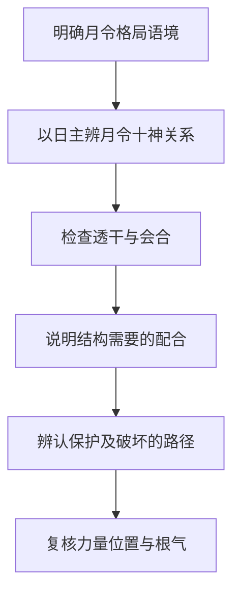

# 论用神

> 《子平真诠》学习笔记 · 第 08 篇。按本系列所用通行篇序排列，不同版本编号可能不同，以篇名为准。正文为概述与推演，不作为古籍原文或评注引文。

本文讨论传统术数的内部规则，不代表经过科学验证的人生预测，不宜用于医疗、投资、婚姻等重大决策。局部例子只用于辨析概念，不含个人四柱。

## 使用用神一词，先交代语境

用神在不同命理讨论中并不总指同一件事。若不先说明语境，很容易一边说用神来自月令，一边又因身弱把印比叫作用神，最后误以为两条判断互相矛盾。本系列依本书课程的月令格局思路展开：先从日主与月令的关系识别结构，再检查透干、会合与其他配合。

后世扶抑语境常用有利于平衡强弱的五行来谈用神，例如身弱时讨论印比。这类问题关心什么力量可能有所帮助，与月令格局分析的起点不同。两者可以相关，但不能在同一段推理中悄悄换义。阅读时，最好先写明自己此刻回答的是格局从何处立论，还是力量如何配合。

## 从月令出发，不是只看一个字

日主提供十神参照，月令提供取用的关键背景。先辨月令所含之气与日主的关系，再看哪些气透出、哪些会合改变了配合，最后观察结构如何运作。月令有时藏气不一，因此从月令取用不等于永远只用一个表面名称概括全局。

透干让某种气在天干层面进入讨论，但透出不等于已经有力；会合使关系改变，也不自动删除月令原有的气。学习者需要把月令、透干与会合连接起来，既不能绕开月令只找一个好听的十神，也不能立了格名后便不再检查实际条件。

## 局部对照：有官，不一定就是官格

设甲生酉月，酉中辛金对甲为正官。若再见辛透，便可以从官格背景出发，讨论官如何得到配合，以及是否受到伤官等作用影响。这只是分析入口，不能把官格背景写成官格已经成就。

另设甲生寅月，天干也见辛。辛对甲仍是正官，但月令背景已经不同：这里应按建禄用官的思路讨论，不能因为天干看见辛就与前例一概称为官格。两例可以有相似的生克链，格局归属却不因此相同。

这个对照说明，十神名称回答某干相对日主是什么；格局名称还要回答月令怎样提供结构背景；成败判断则继续问配合是否成立。三个层次都需要，不宜用其中一个替代其他两个。

## 顺用与逆用，是处理原则

传统课程常把财官印食放在顺用的讨论中，把杀伤劫刃放在逆用的讨论中。顺用强调使相应作用获得合宜的生扶和保护，逆用强调通过制约、转化等配合处理其可能造成的问题。这些是体系内部的处理原则，不是给人贴善恶标签。

以甲日主、辛官、丁伤官的片段为例，若辛正承担所需功能，丁克辛便可能成为要处理的问题。若另有壬丁合且条件有效，可以讨论牵制丁而间接护辛。这是在说明为什么要保护所需功能，不是在说凡印皆好、凡伤官皆坏。

反过来，当七杀需要食神制约时，食神的克制可能正是配合所需。不能因为看到克就认作破坏，也不能因为看到相生就认作帮助。顺逆最终要落到具体结构上，而不是停留在十神的名声上。

## 反例：五行平均不是唯一目标

假设某局印已经偏重，仍因印常被列入顺用便继续增加印，未必有助于原来的配合。或者一见身弱就宣布只能用印比，也会跳过月令结构与各作用的具体条件。强弱分析有价值，但不能把整个体系改写成哪里少就补哪里。

同样，强调月令取用，也不能说本书完全不看力量。一个名义上负责制杀的食神，如果自身无力或受到牵制，便不能只凭名称证明制杀有效。格局给出应检查的作用方向，力量、位置和根气帮助检验这些作用能否发生。

## 自测与答案

1. 甲生寅月见辛，是否只要见官就叫官格？答：不是，应区分建禄用官与甲生酉月的官格背景。
2. 月令格局的用神与扶抑所说有利五行能否直接互换？答：不能，先说明语境，再讨论两者如何关联。
3. 官格背景明确，是否已经证明成格？答：没有，还须检查配合、破坏及作用条件，下一篇据此进入成败救应。

---

[上一篇：论刑冲会合解法](/knowledge/traditional/ziping/branch-interactions) · [下一篇：论用神成败救应](/knowledge/traditional/ziping/formation-failure-and-rescue) · [传统文化](/knowledge/traditional/index)
