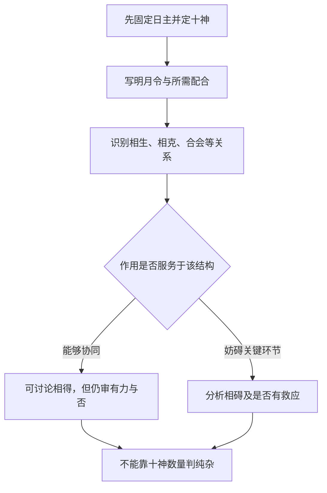

# 论用神纯杂

> 《子平真诠》学习笔记 · 第 11 篇。按本系列所用通行篇序排列，不同版本编号可能不同，以篇名为准。正文为概述与推演，不作为古籍原文或评注引文。

本文讨论传统术数的内部规则，不代表经过科学验证的人生预测。局部例子只用于辨析概念。

十神数量不决定纯杂，相生不自动为纯，相克不自动为杂。
## 三组组合比较

辛日寅月甲丙并透，财生官；癸日未月乙己并透，乙食神制己七杀；戊日申月庚壬并透，庚食神生壬偏财。各例都先判断十神，再看组合所需。
## 容易混淆的地方

“纯杂与生克无关”不够准，应说不由生克字面决定，而由生克是否各得其宜判断。连续相生也可能财党杀，克制也可能食神制杀。
## 自测

食神、财、官三个必比伤官、官两个更杂吗？答：不是，须看实际结构，不能数名字。

## 从“有几种”改问“能否协同”

纯杂讨论的不是符号清单整不整齐，而是各项作用是否围绕所需结构相互配合。同一组五行关系，在不同的月令与取用前提下可能承担不同功能。因此“相生就是纯”“相克就是杂”都过早：我们还不知道所生的是需要的对象，还是正在造成问题的对象。

更准确的说法不是“纯杂与生克无关”，而是“纯杂不由生克字面直接决定”。仍要靠生克关系解释为何相得或相碍，只是不能停在箭头名称这一层。判断纯杂也不能代替强弱；结构方向合宜而作用不足，仍是需要另行处理的问题。

## 例一：辛日寅月，甲丙并透

先定十神：甲为正财，丙为正官。木生火，局部关系为财生官。在官的作用确为所需、财能承接而没有关键干扰的前提下，可以讨论相得，而不是因为出现财、官两个名称就判杂。

但这里不是拿到两个干便直接判纯。丙辛存在五合配对，辛日主参与其中；合怎样影响官的作用，须用第五篇的条件继续审查。财官各有多少力量、是否另有伤官干扰，也都尚未给出。这个例子展示“为什么可能相得”，不提供完整成格结论。

## 例二：癸日未月，乙己并透

癸是阴水，乙为同阴的木，是食神；己为同阴的土，克癸，是七杀。乙木克己土，形式上是相克。如果此处七杀需要制约，而食神确能担任这个任务，食神制杀反可能是相得的配合。

它与财生官的箭头方向不同，但两者都可能服务于各自结构。反过来，若食神已经制杀过度，或本来需要的是另一条承接路径，就不能照搬“食制杀必纯”。所谓相得含有“适合此局需要”的限定，而不只是一张生克口诀表。

## 例三：戊日申月，庚壬并透

戊为阳土，庚为食神，壬为偏财，庚金生壬水。这里可以从食神生财理解衔接：食神所泄之气进一步流向财。但必须检验日主、食神与财之间是否承接得住，不能把持续泄耗本身当成无条件的好事。

三例只展示局部关系，不公开个人命盘，也不对现实财富、职业或婚姻作判断。它们的共同点不在“全是相生”，而在都要追问：这一生一克在维护什么？

## 两个反例：好看的链条也要审查

**连续相生不保证相得。** 伤官生财、财又生杀，看上去是一条顺生链，但若财转而助长了需要控制的杀，就可能引入新问题。此时不能停在“流通”两个字。还须检查伤官是否仍有制杀作用、其他配合能否处理新矛盾。

**克制不保证相碍。** 前述乙食神克己七杀，在制杀合宜时可以成为所需关系；但换到官杀正在承担制刃功能的前提，食伤克官杀又可能破坏关键环节。不能脱离原来的任务，只看到“食伤克官杀”便给出统一结论。

## 复盘表：把判断写成可以检验的句子

| 不充分的结论 | 应补充的解释 |
| --- | --- |
| 有三种十神，所以杂 | 三者分别承担什么功能，哪两项相碍 |
| 财生官，所以纯 | 官是否所需，财官作用是否能落实，有无伤合干扰 |
| 食神克杀，所以凶 | 七杀是否需要制，食神能否适度制杀 |
| 全局相生，所以好 | 生到谁、谁继续受益，是否助长了原有败因 |

## 自测与答案

1. 食神、财、官三个名称一定比伤官、官两个更杂吗？不一定。数量不表示配合质量，后者也不能只凭两神名就判断结局。
2. 两个局部例子都有相克，为什么一个相得、一个相碍？因为所需维护的结构不同。先写前提，再分析箭头的作用。
3. “纯”是否等于整个命局已经有力且层次高？不是。纯杂、强弱、成败与格局高低不是同一问题；不能用本章的一个判断提前完成后续全部分析。

第十二篇的格局高低是后续学习方向，本系列此处不把它写作已经系统完成的章节。读完本篇可回到第九篇，尝试用同一张关系图分别回答“成败在哪里”和“配合是否相得”。

---

[上一篇：论用神变化](/knowledge/traditional/ziping/changes-of-useful-god) · [传统文化](/knowledge/traditional/index)
