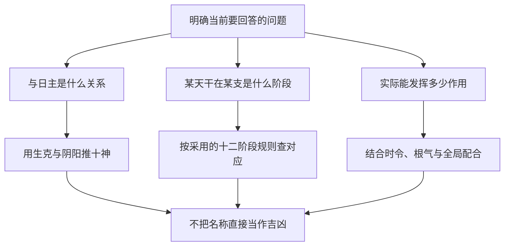

# 论阴阳生死

> 《子平真诠》学习笔记 · 第 03 篇。按本系列所用通行篇序排列，不同版本编号可能不同，以篇名为准。正文为概述与推演，不作为古籍原文或评注引文。

本文讨论传统术数的内部规则，不代表经过科学验证的人生预测。局部例子只用于辨析概念。

## “生死”是阶段术语，不是现实判词

这一章最容易误读的地方，是把长生、帝旺、病、死、绝等名称直接套到现实生活。它们首先是一套传统术数的阶段标记：以某一天干为观察对象，考察它在不同地支位置所对应的状态。名称带有生长衰退的比喻，并不构成人体健康或寿命的证据。

十二阶段的顺序为：长生、沐浴、冠带、临官、帝旺、衰、病、死、墓、绝、胎、养。记顺序的目的，是能在同一套规则中识别阶段前后，而不是给十二个名称排一张“从吉到凶”的分数表。阶段顺序与吉凶高低不是同一条轴。

## 本系列采用什么规则

这里沿用学习中采用的阳干顺行、阴干逆行体系。先确定所观察的天干，再按相应的起点与方向查地支，不能把一个天干的阶段表直接复制给所有同五行天干。关于阴阳顺逆、土的寄生等问题，传统解释存在分歧；本篇说明所用规则，不把它写成各流派一致的结论。

先掌握已有材料中的甲木例子即可：甲木长生在亥，临官在寅，帝旺在卯。这里明确的是“甲对某地支”的阶段对应，不是说亥只能属于甲，也不是给亥、寅、卯各自贴上永远不变的强弱标签。分析不同天干时，观察对象必须重新确认。

## 为什么甲木长生不在春季

一个常见疑问是：木在春季繁盛，为何甲木长生却在亥？关键在于不能把“气开始发生”与“外观最繁盛”视为同一时刻。传统解释把开始、成长、旺盛、衰退安排在一个循环中，长生表达的是发生阶段，帝旺表达的是另一阶段，二者本来就不是同义词。

这只是术数内部的符号解释，不应借植物发芽、光照或现代生物学为它作科学证明。若以日常语言理解“出生一定最有力”，就会误把长生等同帝旺；若把冬季植物外观作为唯一依据，又会把传统符号与经验观察强行混合。读古籍概念时，先分清它是在使用哪套语言。

## 阶段、十神、力量要分开记录

同一个局部材料，可以有三个不同问题。十神问的是目标天干与日主有什么关系；十二长生问的是某天干在某地支处于什么阶段；力量判断问的是它在具体配置中究竟能发挥多少作用。三者有关联，但没有哪一个能自动代替另两个。

以甲日主见庚的片段为例，庚金克甲木，甲庚同阳，可先确定庚为七杀。这个答案没有告诉我们庚在哪个阶段，也没有告诉我们庚实际多强。若材料只给这两个天干，就应停在可确定的关系上，不补造地支，不靠“杀”字猜测力量。

## 两个不能成立的跳步

第一种跳步是“甲见卯为帝旺，所以整局一定身强”。帝旺对应可以记录，但全局仍需查看根的状态、其他干支的帮扶与克泄耗，以及作用是否落实。这里不是否认卯的意义，而是否认一个阶段名称已经包含所有条件。

第二种跳步是“见死绝就一定发生死亡或灾难”。这把象征术语变成了现实事件预测，既越出了概念本身，也没有可靠科学依据。与之相对，“长生必吉”同样不成立。两个方向都要守住边界，而不是只纠正听起来不吉利的一边。

## 自测与答案

1. 甲木长生在亥，是否意味着亥比卯更旺？答：不能这样推，长生与帝旺是不同阶段，不能把“发生”当成“最盛”。
2. 甲见庚已定七杀，是否已完成庚的强弱判断？答：没有，只完成了十神命名。
3. 甲临官寅、帝旺卯，是否可把这个对应不加区分地套给所有木干？答：不可，应先确认天干及所采用的顺逆体系。
4. “死”能否作为健康结论？答：不能，它是本体系的阶段名称，不是医学判断。

本篇的学习目标是正确使用阶段语言，并知道何时必须暂停推论。

---

[上一篇：论阴阳生克](/knowledge/traditional/ziping/yin-yang-and-ten-gods) · [下一篇：论十干配合性情](/knowledge/traditional/ziping/heavenly-stem-combinations) · [传统文化](/knowledge/traditional/index)
