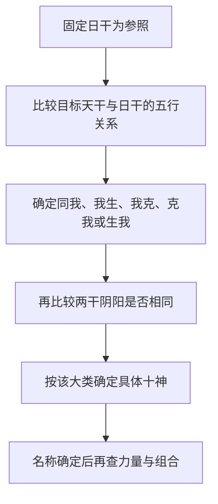

# 论阴阳生克

> 《子平真诠》学习笔记 · 第 02 篇。按本系列所用通行篇序排列，不同版本编号可能不同，以篇名为准。正文为概述与推演，不作为古籍原文或评注引文。

本文讨论传统术数的内部规则，不代表经过科学验证的人生预测。局部例子只用于辨析概念。

## 十神首先是相对关系

十神名称容易让人先想到好坏，但这一章要先完成更基础的工作：以日干为固定参照，给其他天干的关系命名。同一个字换了日主，十神可以改变；同一个命局中，即便讨论两个非日主天干的相互作用，也不能随手更换日主。关系名称准确，后面谈配合才有共同语言。

推导只需两步：先用五行生克确定大类，再用阴阳同异确定具体名称。不要反过来先猜“这是官还是财”，然后为了凑答案改动生克方向。尤其“我生”与“生我”、“我克”与“克我”各有方向，差一个字就会落入另一类。

## 两步法怎样落地

以日主为“我”，五类关系分别这样展开：

- 同我：同阴阳为比肩，异阴阳为劫财。
- 我生：同阴阳为食神，异阴阳为伤官。
- 我克：同阴阳为偏财，异阴阳为正财。
- 克我：同阴阳为七杀，异阴阳为正官。
- 生我：同阴阳为偏印，异阴阳为正印。

这里的“同”是日主与目标天干阴阳相同，不是两者五行相同。例如甲与庚都为阳干，虽然一个属木、一个属金，仍属于阴阳相同。这也是为什么第一步和第二步必须拆开，不能把五行同异误当成阴阳同异。

## 用甲日主做一次完整推导

甲为阳木，辛为阴金。第一步，金克木，所以辛属于“克我”；第二步，甲阳、辛阴，阴阳不同，因此辛是甲的正官。若把辛换成庚，仍是金克木，但甲庚同阳，故庚为七杀。两者都克甲，却有不同的十神名称。

再看甲与丁。木生火，是“我生”；甲阳、丁阴，阴阳不同，所以丁为伤官。看甲与壬，则水生木，是“生我”；甲壬同阳，所以壬为偏印。每次都完整走过两步，比单背“甲见某字是什么”更容易迁移到其他日主。

现在把日主换成乙，仍看辛。金克木的方向不变，但乙辛同阴，辛就成了七杀。这不是辛改变了自身属性，而是比较对象变了。十神不是某个天干永远携带的固定标签。

## 为什么官杀同克日主，处理却不同

定义层只告诉我们正官、七杀都属于“克我”，并用阴阳区分。传统格局法会进一步讨论不同组合中的处理方式，例如正官常讲保护，七杀常讲制化。但这些是结构判断，不是从名称直接推出的吉凶保证。

因此，“正官一定好，七杀一定坏”不是本篇的结论。某个官星是否为当前结构所需，某个七杀是否得到合宜制化，还要结合月令、力量、位置和其他关系。十神名称是分析入口，不是人生结论，也不能据此评价一个人的品德。

## 一个容易混乱的反例

设局部材料为甲日主，另见丁、辛。丁火克辛金，这是两个非日主天干之间的生克关系。若临时以辛为参照，丁确实属于同阴相克；但本例的日主仍是甲，不能把丁在本局改名为七杀。正确写法是：丁为甲的伤官，辛为甲的正官，丁克辛，构成伤官克官的关系。

这段练习不意味着已经判定全局败格。这里只确认了名称与作用方向，尚未检查丁辛是否有力、作用能否落实、有没有其他配合。先描述关系，再检验条件，才能避免把局部公式夸大成完整断语。

## 自测与答案

1. 甲见庚，先查阴阳还是先查生克？答：先定金克木为“克我”，再定同阳为七杀。
2. 辛对甲是正官，对乙仍是正官吗？答：不是，乙辛同阴，辛对乙为七杀。
3. 甲日主见丁克辛，丁是否改叫七杀？答：不改，丁仍为伤官；相互生克不会自动更换本局参照。
4. 判断为七杀后，是否已经知道它很强？答：没有，关系名称与实际力量须分别判断。

本篇整理已学基础规则，不冒充第二章逐句原文解释。

---

[上一篇：论十干十二支](/knowledge/traditional/ziping) · [下一篇：论阴阳生死](/knowledge/traditional/ziping/twelve-stages) · [传统文化](/knowledge/traditional/index)
