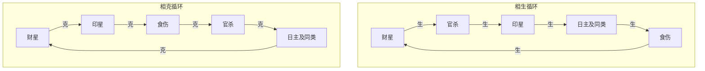
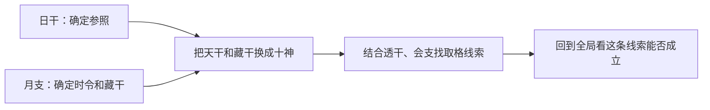

# 01-十神与月令

> 《子平真诠》第一轮通读笔记 01｜十神与月令 · 刑冲会合 · 取格与判格 · 行运通则 · 各格精读与取运

第一遍读完《子平真诠》，我想按五个主题来整理，不逐章复述。第一篇先把两个基础问题说清楚：**十神是怎么算出来的？已经认出了十神，为什么还要从月令开始读？**

回看学习时做过的题，我发现真正容易混的不是十个名称，而是把三个不同层次的判断连成了一步：**认出是什么十神、确定先从哪里入手、判断它在这一局里起什么作用。**

## 十天干的五行与阴阳

一柱由一个天干和一个地支组成，如「甲子」的甲是天干，子是地支。十天干按甲、乙、丙、丁、戊、己、庚、辛、壬、癸排列，每个五行有一阳一阴：

| 五行 | 阳干 | 阴干 |
| --- | --- | --- |
| 木 | 甲 | 乙 |
| 火 | 丙 | 丁 |
| 土 | 戊 | 己 |
| 金 | 庚 | 辛 |
| 水 | 壬 | 癸 |

认十神要先会两条关系。相生一圈是**木→火→土→金→水→木**；相克一圈是**木→土→水→火→金→木**。先用生克判断是哪一组关系，再用阴阳同异区分那一组里的两个十神。

## 十二地支的五行、阴阳与藏干

地支也有**自身的阴阳和五行**。按子、丑、寅、卯……顺数，奇数位为阳，偶数位为阴。五行可以按四季记：寅卯木、巳午火、申酉金、亥子水；辰、未、戌、丑是四季末的土支。支的归属只说它的主要五行，不代表支里只藏这一种五行。

**藏干**是传统子平法列在地支内部的天干。**本气**是该支所藏的代表性天干，五行与支相同；其余兼藏在教学表里常再分为**中气**和**余气**。下表采用一种常见排法，方便查字。不同资料对部分兼藏（如巳中的庚、戊）的中气、余气排序有差别；本表不把它们当成固定权重，也不拿来代替按节气分日论司令的表。

| 地支 | 支的阴阳 | 支的五行 | 藏干本气 | 中气 | 余气 |
| --- | --- | --- | --- | --- | --- |
| 子 | 阳 | 水 | 癸 |  |  |
| 丑 | 阴 | 土 | 己 | 辛 | 癸 |
| 寅 | 阳 | 木 | 甲 | 丙 | 戊 |
| 卯 | 阴 | 木 | 乙 |  |  |
| 辰 | 阳 | 土 | 戊 | 癸 | 乙 |
| 巳 | 阴 | 火 | 丙 | 庚 | 戊 |
| 午 | 阳 | 火 | 丁 | 己 |  |
| 未 | 阴 | 土 | 己 | 乙 | 丁 |
| 申 | 阳 | 金 | 庚 | 壬 | 戊 |
| 酉 | 阴 | 金 | 辛 |  |  |
| 戌 | 阳 | 土 | 戊 | 丁 | 辛 |
| 亥 | 阴 | 水 | 壬 | 甲 |  |

表中空白表示这套藏干表没有另外列干。藏干名单可与[《渊海子平·又地支藏遁歌》](https://zh.wikisource.org/zh-hant/淵海子平#又地支藏遁歌)对照；歌诀列的是所藏的字，它的字序不等于上表的分栏。

最容易混的是**地支自身的阴阳，不等于藏干的阴阳**。比如子是阳水，里面藏的却是阴水癸。以阳木甲为日主，癸水生甲木、阴阳相异，所以子中癸是**正印**；若错用子的阳来算，就会错判成偏印。再看午：午是阳火，本气却是阴火丁。对甲而言，午中丁是**伤官**，兼藏的己土则是**正财**。同一地支里可以有不止一个十神，算的时候要逐个取藏干。

## 十神：以日干为参照的五组关系

有了前面两张表，就可以认十神了。日柱的天干叫**日干**，也叫**日主**。无论是四柱上明写的天干，还是从地支查出的藏干，都与日主比较：先看五行生克，再看阴阳同异。

以甲木为日主为例：

| 与日主的关系 | 同阴阳 | 异阴阳 |
| --- | --- | --- |
| 与我同类：木与木 | 甲，比肩 | 乙，劫财 |
| 我生：木生火 | 丙，食神 | 丁，伤官 |
| 我克：木克土 | 戊，偏财 | 己，正财 |
| 克我：金克木 | 庚，七杀（偏官） | 辛，正官 |
| 生我：水生木 | 壬，偏印 | 癸，正印 |

不必先背十张表。比如辛是阴金，克阳木甲，阴阳相异，所以辛对甲是正官。换成阴木乙，辛仍是阴金，仍然金克木，但现在阴阳相同，辛对乙就是七杀。**字没变，参照一换，十神就变了。**

学习时我还做过一道乙木日主的题：甲木对乙木是劫财。但知道这一点，还答不出它在某个结构中是帮忙还是添乱。若结构需要保印，减少财对印的牵制或许有利；若结构需要财来制过重的印，削弱财反而可能不利。两种读法都要检查全局，不能凭「劫财」二字下结论。

### 十神之间的两条生克循环

十神的名称都以日主为参照，但认完名字，还要看这些十神**彼此**怎样作用。把十神按五行关系归成五组，就能把相生、相克各画成一圈。图里「身」指日主；比肩、劫财和日主是同一五行，所以画在同一组，但日主本身不叫比劫。

- **相生**：财生官杀 → 官杀生印 → 印生身 → 身生食伤 → 食伤生财，回到财。
- **相克**：财克印 → 印克食伤 → 食伤克官杀 → 官杀克身 → 比劫克财，回到财。最后一步若说的是日主本身克财，从认十神的角度叫「我克者为财」；若说的是局中同类之字克财，才是「比劫克财」。

图里画的是一般关系，**财坏印、枭神夺食、食伤制杀**则要说清克的是谁、起了什么效果。比如偏印克到关键的食神，使它不能发挥作用，才是这里所说的「枭神夺食」；不能见偏印就断夺食。食伤克官杀，可能是食神有效制住七杀，也可能是伤官损了本来要保护的正官。财克印同样可能损了护身的印，也可能制住夺食的偏印。

用甲日的几个字试读：**壬偏印克丙食神，丙食神又能克庚七杀；戊偏财一边克壬，一边生庚。** 只盯着各字和甲的关系，看不出戊为什么有时保住了食神，有时反而助了七杀。先把箭头画出来，再看哪条作用在这一局里真的成立。第三篇会用这组字细看成败救应。

## 月令：从月支找取格的线索

这里说的**月令**，是月柱的地支及其所代表的时令背景。它不是月干，也不是把公历或农历月份的数字直接换成一个地支；四柱排月通常依节气交接。本文直接用已知月支的例子，不展开排盘。

《论用神》开篇说：「八字用神，专求月令。」后面紧接着讲以日干配月令地支。对我来说，最实用的读法是：**日干是认十神的参照，月支是找取格线索的起点。** 这里的「用神」偏重月令格局中的取用，别直接套成「缺什么就补什么」，也别与别的命理体系所说的扶抑用神混成一个概念。

用最简单的一组看：**甲木生酉月**。酉藏辛，辛对甲是正官，所以先沿正官这条线索读。假设天干另见己土，己对甲是正财，土能生金，于是有了「财生官」这条关系。此时可以继续问它是否构成「官逢财生」，但光凭甲、酉、己三个信息，还不足以判正官格一定成立。

学习会话里还有一个反过来的对照：仍是甲木，月令改为**丑**。丑藏己、癸、辛。如果全局配合支持以己财为中心，辛官又确实能辅助财格，同一对「己土、辛金」就可以换成从「财旺生官」的角度来看。这里是有意省略其他干支的对照题，**不是说甲生丑月就必然取财**。这道题让我区分开了：土生金是五行关系；先围绕财还是围绕官看，是结构判断。

## 从藏干到透干、通根

地支里藏着某个天干，和那个天干写在四柱上，读法不同。把方向分开就好记：

- **藏干**：从地支往里看，这一支藏了哪些天干。
- **透干**：月支里藏着的某个天干，也出现在四柱天干上。它原本就藏在支中，现在又明见于干。
- **通根**：反过来，从一个已出现的天干往地支看，有没有能支持它的根气。是否透出与是否有根，是两件事。

复习时那道「庚透干和申支出现能不能等同」很适合检验这组概念。仍以甲木看，庚透就是七杀明见；申虽藏庚，也藏壬、戊，只见一个申，不能直接按庚透处理。反过来，辛没有透出，也不能因此把酉月的辛略掉。**藏干有作用，只是不能照搬天干透出的读法。**

## 月支藏多个天干时：看透干与会支

最容易用错的捷径是「永远只看本气」。酉只藏辛，例子好算；换成甲木生辰月，就不够了。《论杂气如何取用》正好用这个例子说明：

| 辰中藏干 | 对甲的十神 | 该干透出时，可以先看 |
| --- | --- | --- |
| 戊（本气） | 偏财 | 偏财这条线索 |
| 癸（中气） | 正印 | 印绶这条线索 |
| 乙（余气） | 劫财 | 月劫这条线索 |

书里又给了一层对照：甲生辰月，癸透，地支再见申、子，与辰构成水局的例子中，透出的癸印与会支给出的水势指向同一边。在这个例子里，只看「辰是土」就会漏掉印绶这条主线；只看「有癸」也没有交代为什么月支和其他地支的配合重要。至于什么条件下会合成立、遇到冲又怎么办，放到第二篇讲。

## 这一篇留下的三个问题

下次看到一个简例，我可以先写三行：

1. **它是什么？** 从日干出发，按生克和阴阳认十神。
2. **它从哪里来？** 看它在月支所藏、透在天干，还是主要由地支会合显出。
3. **现在能判断到哪一步？** 只有部分干支，就先保留为取格线索。等全局配合齐全，再谈成败、救应和喜忌。

一个小自测：同是甲日，见丁，一处是丁直接透在时干，另一处是只见午支而丁未透。两处的丁对甲都叫伤官，但能不能直接当成同一种情况？**不能。** 十神身份一样，一个明见，一个藏在午中；午还藏己，要继续看它在全局里怎么起作用。

下一篇《刑冲会合》就从第三行接下去：原本已经认出的关系，遇到合、冲或会局后，到底是哪一处变了？

### 重读线索

- 沈孝瞻《子平真诠》：《论十干十二支》《论阴阳生克》《论用神》《论用神变化》《论杂气如何取用》《论喜忌干支有别》。按篇名找即可，不同版本的编次可能有别。
- [《子平真诠》馆藏扫描本](https://upload.wikimedia.org/wikipedia/commons/d/d5/NLC416-13jh002326-46443_%E6%B7%B5%E6%B5%B7%E5%AD%90%E5%B9%B3_%E5%AD%90%E5%B9%B3%E7%9C%9F%E8%A9%AE_%E7%AC%AC2%E5%8D%B7.pdf) · [《论杂气如何取用》原文](https://luckclub.cn/bazi/002/018/)

*本文是传统命理文献的阅读笔记，例子仅用于比较书中的推理方式，不用于作个人预测。*
