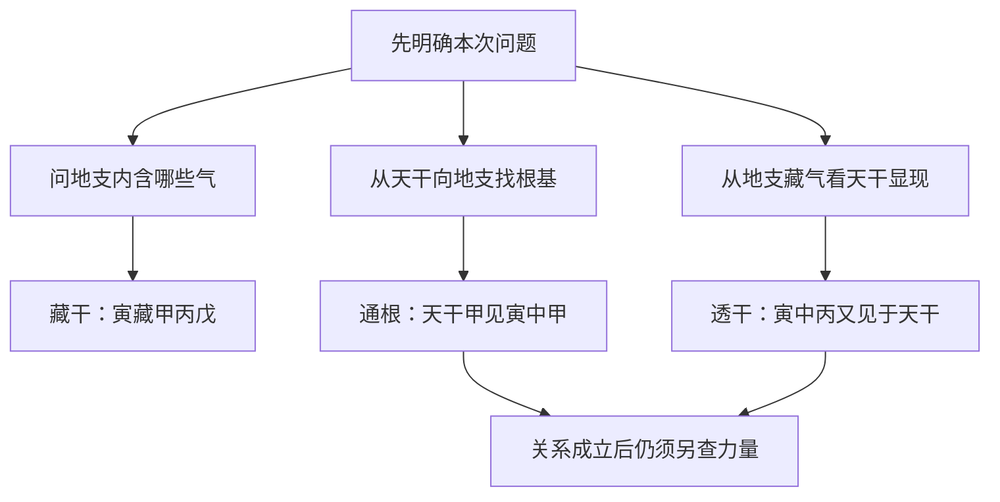

# 01 论十干十二支

> 《子平真诠》学习笔记 · 原书第 01 篇。篇序按原书通行本排列，不同版本编号可能不同，以篇名为准。正文为概述与推演，不作为古籍原文或评注引文。

本系列从符号、关系与力量逐步进入月令格局。命理预测缺乏可靠的现代科学验证；这里讨论传统文献的概念与内部推演，不应用于医疗、投资、婚姻等重大决策。文中例子仅保留教学所需的局部关系，不能据此判断完整命局。

## 先把符号与判断分开

读这一章，第一步不是预测吉凶，而是认清后文反复使用的语言。十天干依次为甲、乙、丙、丁、戊、己、庚、辛、壬、癸；按五行分为甲乙木、丙丁火、戊己土、庚辛金、壬癸水。每组又分阴阳：甲丙戊庚壬为阳，乙丁己辛癸为阴。阴阳是这套符号系统的分类，不等于人的好坏，也不是把同一五行分成强弱两级。

十二地支依次为子、丑、寅、卯、辰、巳、午、未、申、酉、戌、亥。天干与地支不能只当作两套可互换的字母：地支还涉及时令、藏干以及彼此关系。本篇先抓住藏干，不急于把所有规则堆在一起。这样读到后面的月令、通根、透干时，才知道一句话究竟在回答什么问题。

## 日干是十神的参照点

日干又称日主，是推导十神时固定的观察中心。例如以甲为日主，看到另一个天干，先比较它与甲的五行生克，再比较阴阳，才能得到具体十神。日主不是每遇到一条生克关系就更换的参照，也不是看见哪个字力量大，就临时把哪个字当作中心。

这里应保留两层记录：一层是某个天干本身属什么五行、什么阴阳；另一层是它相对于当前日主是什么十神。辛本身始终属阴金，但换了日主，它的十神名称可以不同。先记清符号属性，再讨论相对关系，能避免后续分析反复改名。

## 藏干、通根、透干各在问什么

以寅藏甲、丙、戊为例，藏干回答的是“这个地支中包含哪些天干之气”。这是从地支内部说明其构成，并不表示甲、丙、戊已经全部出现在天干位置，也不表示三者在任何情况下都同样有力。

通根则从天干出发，向地支寻找根基。局部配置中，天干有甲，地支有寅，寅中又藏甲，就可以用来说明甲通根于寅。这里的重点是天干与地支之间存在根气联系。至于根的状态、其他位置的作用以及全局强弱，不能由“有根”两个字一并代答。

透干换了观察方向：先看某支所藏之气，再看它有没有在天干显现。寅中藏丙，天干又见丙，就可讨论丙从寅中透出。透干不限定在年干，也不能把它缩成“年柱出现某字”的专门规则。判断时应说清从哪个地支看哪个天干，避免只写一个“透”字而省掉依据。

## 同一组材料，可以回答不同问题

设一个匿名教学片段只有“天干见甲、丙，地支见寅”。问寅中有哪些气，答甲丙戊，是藏干；问甲有没有地支根基，可以指向寅中甲，是通根；问寅中丙有没有显现于天干，可以指向已出现的丙，是透干。三个答案可以并存，区别在观察方向，不必争论哪一个名称才能独占这组材料。

反过来，只知道寅藏丙，却未给出天干有丙，不能说丙已经透干；只知道天干有甲，却没有提供地支信息，也不能凭空认定它有根。天干出现某字，只完成“看见它”这一步，尚未证明它在全局中能发挥多大作用。这正是把符号识别与力量判断分开的价值。

## 自测与答案

1. 甲在天干，寅在地支，引用寅中甲来说明甲的根基，属于什么？答：通根，观察起点是天干甲。
2. 寅藏丙，天干也有丙，是否只有丙在年干才叫透干？答：不是，不能把透干限定在年干。
3. 寅藏甲丙戊，是否说明三者都已透出且一样旺？答：都不能。藏干、透干与力量是三个需要分别核查的问题。

本篇是已学基础知识的整理，不声称完成第一章逐段原文训释。读完后应能先说明“我正在看哪一层”，再进入下一篇的阴阳生克。

---

[下一篇：论阴阳生克与阴阳生死](/knowledge/ziping/02-论阴阳生克与阴阳生死) · [子平命理](/knowledge/ziping/index)
