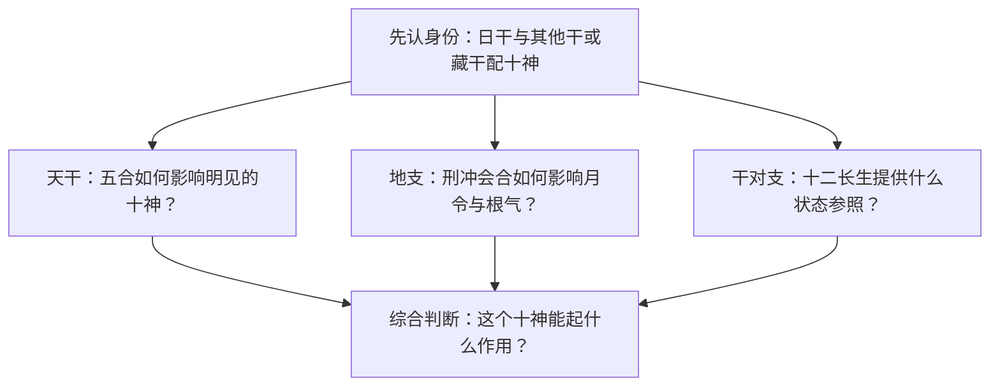

# 02-刑冲会合

> 《子平真诠》第一轮通读笔记 02

第一篇解决的是**认十神**：以日干为参照，按五行生克和阴阳同异，给其他天干和藏干定名。第二篇的问题是：**十神认出来以后，它在这一局里还能不能起原先想的作用？**

以甲木为例，辛是正官，丙是食神。这两个名称很容易算。但如果丙辛相合，辛的作用要重看；酉中也藏辛，如果酉受到卯冲，正官所依的地支条件又要重看。十二长生还会补一层信息：这个天干到了这个地支，按书里的说法处于什么阶段。三层分别在看**天干的配合、地支的牵连、天干在地支上的状态**。

| 层次 | 看什么 | 对十神分析补充什么 |
| --- | --- | --- |
| 天干 | **干与干**：五合、合而不合、能否化气 | 明见的十神有没有被别的天干牵制，能否照原先的关系起作用 |
| 地支 | **支与支**：六合、六冲、刑、三会、三合 | 月令、藏干、根气和整体气势所处的条件有没有变 |
| 干对支 | **一个天干对一个地支**：十二长生 | 给这个天干在该支的状态一个参照，再与月令、通根和全局配合互证 |

## 一、天干五合与化气

五合有五组固定配对：**甲己配土、乙庚配金、丙辛配水、丁壬配木、戊癸配火**。这里的「配水」只是说明丙辛若能化，按传统说法化水，不是见到丙辛就把两字都当水。

我在练习中用三个问题把它拆开：

1. **配不配？** 先查是否为五合中的一对。
2. **合不合？** 看谁与谁合、位置远近、是否有其他干相隔或竞争，以及日主是不是其中一方。即使同一对字，牵制的对象也可能不同。
3. **化不化？** 在已经讨论相合的基础上，再看化出的五行有没有得到时令和全局气势支持。只凭配对不能定化，也不能直接定为特殊的化气格。

沿用甲日酉月：假设丙、辛都透，辛对甲原是正官，丙是食神。如果这一对实际发生牵制，先重新看**透出的辛还能否按原先的方式发挥正官作用**。没有证据能化水，就不从「丙辛合」跳到「正官变成印」，也不能说酉中所藏的辛随之消失。

## 二、地支的合、冲、刑、会

先把组合认出来，再看它落在哪个位置、牵动了谁。常见组合可以放在同一张表里：

| 关系 | 组合 | 记法 |
| --- | --- | --- |
| 六合 | 子丑、寅亥、卯戌、辰酉、巳申、午未 | 两支固定配对 |
| 六冲 | 子午、丑未、寅申、卯酉、辰戌、巳亥 | 十二支排一圈，隔六位正对 |
| 刑 | 子卯；寅巳申、丑戌未两组；辰、午、酉、亥各有自刑说法 | 传统分组，不能拿六冲的「隔六位」推 |
| 三会 | 寅卯辰木、巳午未火、申酉戌金、亥子丑水 | 同一季节连续三支，会成一方 |
| 三合 | 亥卯未木、寅午戌火、巳酉丑金、申子辰水 | 同一五行的生、旺、墓三支相配 |

**三会看季节，三合看生旺墓。** 比如寅在寅卯辰里是春季三支之一，在寅午戌里则是火局的生支。两个组合用到同一个寅，问的却不是一回事。古书也会把申子辰这一类称作「会」，本文统一用常见的现代区分。三支齐全时先认出组合，再看是否受冲、能发挥到什么程度，不凭表格就定结果。

回到甲日酉月：酉是月令，见卯先认出**卯酉冲**；再见戌，则卯与戌另有**六合**。书里用这一例说明合可以解冲。之前做题时，我把它说成「卯被合，所以卯木变弱」。现在会说得更具体：**卯对酉原有的冲被另一条关系牵制；卯木的整体强弱要另外判断。**

反过来，书里还举甲生子月、两卯并见的例子：按该例原先不作刑论；戌合其中一卯后，留下的另一卯反而与子按刑论。两例放一起就好记了：有合以后，要**重看剩下谁、原来的关系还能不能起作用**，没有「有合就解冲刑」的通用顺序。

## 三、十二长生：给天干在地支上的状态一个参照

书里把一个天干配到十二支时的状态，分成十二个阶段：

**长生 → 沐浴 → 冠带 → 临官 → 帝旺 → 衰 → 病 → 死 → 墓 → 绝 → 胎 → 养**

按原文的「阳顺阴逆」读法，甲从亥长生顺排，乙从午长生逆排。比如甲在亥为长生、在酉为胎。这里是把**一个天干与一个地支**配起来看，不是两支相合，也不是重算十神。「胎」「死」「绝」只是传统术语，不按字面理解。

继续用酉月这个例子：**甲在酉为胎**，说的是甲对酉的长生阶段；**酉中辛对甲是正官**，说的是五行和阴阳关系。两个判断能同时成立。也不能仅凭一个「胎」字就判甲弱，还要看月令是否支持、其他地支有无根、同类和印星是否生扶，以及克泄耗如何。这也是《论十干得时不旺失时不弱》提醒我的地方。

## 回到十神：先认身份，再看能不能用

把甲日酉月的几个局部练习并排看：

| 已经知道 | 加入的新条件 | 需要重看的问题 |
| --- | --- | --- |
| 透出的辛是正官 | 丙辛可能相合 | 这个辛明见，但还能不能按原先的方式发挥作用？ |
| 酉中辛是月令取官的线索 | 卯冲酉，另见卯戌合 | 月令所受的冲有无变化？哪条关系改变了它？ |
| 甲在酉为胎 | 其他支可能有根，全局也可能有生扶 | 这个阶段名是否与全局判断一致？还缺什么证据？ |

这几行是从同一个起点做的**局部对照**，不是一张完整的四柱，也不据此定成败。对我来说，这一篇真正要记住的就是：**第一篇认出「它是谁」，第二篇补看「它和谁发生了什么、因此还能做什么」。** 下一篇《取格与判格》再讨论哪些关系足以成格、破格或救应。

### 重读线索

- [《子平真诠》馆藏扫描本](https://upload.wikimedia.org/wikipedia/commons/f/fe/NLC416-11jh010455-35296_%E5%AD%90%E5%B9%B3%E7%9C%9F%E8%A9%AE.pdf)：《论阴阳生死》《论十干配合性情》《论十干合而不合》《论十干得时不旺失时不弱》《论刑冲会合解法》。版本篇名和编次略有差别。
- [《论刑冲会合解法》原文与徐乐吾评注](https://www.mastervt.com/books/zipingzhenquanpingzhu/juan-1/chapter-009)：对照卯酉冲、卯戌合和两卯一子的例子。

*本文是传统命理文献的阅读笔记，局部例用来理解书中的推理方式。*
