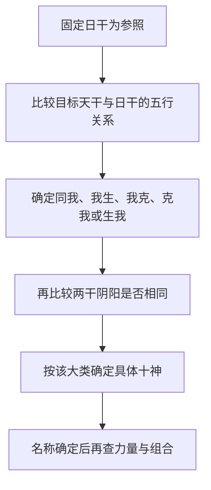
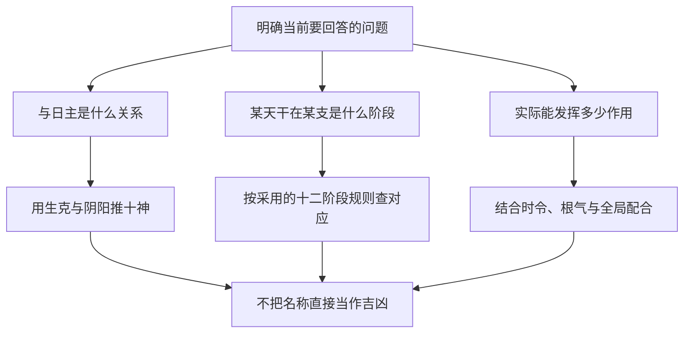

# 02 论阴阳生克与阴阳生死

> 《子平真诠》学习笔记 · 原书第 02–03 篇。篇序按原书通行本排列，不同版本编号可能不同，以篇名为准。正文为概述与推演，不作为古籍原文或评注引文。

本文讨论传统术数的内部规则，不代表经过科学验证的人生预测。局部例子只用于辨析概念。

生克与生死，是同一组干支符号上的两种提问。生克问两个天干之间是什么关系，据此推出十神；生死问某个天干落在某个地支上属于哪个阶段，据此记下长生、帝旺、死绝。两者都不直接回答"力量有多大"，更不能互相替代。把它们与力量判断混为一谈，后面的取用就失去依据。

## 十神首先是相对关系

十神名称容易让人先想到好坏，但这一章要先完成更基础的工作：以日干为固定参照，给其他天干的关系命名。同一个字换了日主，十神可以改变；同一个命局中，即便讨论两个非日主天干的相互作用，也不能随手更换日主。关系名称准确，后面谈配合才有共同语言。

推导只需两步：先用五行生克确定大类，再用阴阳同异确定具体名称。不要反过来先猜"这是官还是财"，然后为了凑答案改动生克方向。尤其"我生"与"生我"、"我克"与"克我"各有方向，差一个字就会落入另一类。

## 两步法怎样落地

以日主为"我"，五类关系分别这样展开：

- 同我：同阴阳为比肩，异阴阳为劫财。
- 我生：同阴阳为食神，异阴阳为伤官。
- 我克：同阴阳为偏财，异阴阳为正财。
- 克我：同阴阳为七杀，异阴阳为正官。
- 生我：同阴阳为偏印，异阴阳为正印。

这里的"同"是日主与目标天干阴阳相同，不是两者五行相同。例如甲与庚都为阳干，虽然一个属木、一个属金，仍属于阴阳相同。这也是为什么第一步和第二步必须拆开，不能把五行同异误当成阴阳同异。

## 用甲日主做一次完整推导

甲为阳木，辛为阴金。第一步，金克木，所以辛属于"克我"；第二步，甲阳、辛阴，阴阳不同，因此辛是甲的正官。若把辛换成庚，仍是金克木，但甲庚同阳，故庚为七杀。两者都克甲，却有不同的十神名称。

再看甲与丁。木生火，是"我生"；甲阳、丁阴，阴阳不同，所以丁为伤官。看甲与壬，则水生木，是"生我"；甲壬同阳，所以壬为偏印。每次都完整走过两步，比单背"甲见某字是什么"更容易迁移到其他日主。

现在把日主换成乙，仍看辛。金克木的方向不变，但乙辛同阴，辛就成了七杀。这不是辛改变了自身属性，而是比较对象变了。十神不是某个天干永远携带的固定标签。

## 为什么官杀同克日主，处理却不同

定义层只告诉我们正官、七杀都属于"克我"，并用阴阳区分。传统格局法会进一步讨论不同组合中的处理方式，例如正官常讲保护，七杀常讲制化。但这些是结构判断，不是从名称直接推出的吉凶保证。

因此，"正官一定好，七杀一定坏"不是本篇的结论。某个官星是否为当前结构所需，某个七杀是否得到合宜制化，还要结合月令、力量、位置和其他关系。十神名称是分析入口，不是人生结论，也不能据此评价一个人的品德。

## 一个容易混乱的反例

设局部材料为甲日主，另见丁、辛。丁火克辛金，这是两个非日主天干之间的生克关系。若临时以辛为参照，丁确实属于同阴相克；但本例的日主仍是甲，不能把丁在本局改名为七杀。正确写法是：丁为甲的伤官，辛为甲的正官，丁克辛，构成伤官克官的关系。

这段练习不意味着已经判定全局败格。这里只确认了名称与作用方向，尚未检查丁辛是否有力、作用能否落实、有没有其他配合。先描述关系，再检验条件，才能避免把局部公式夸大成完整断语。

## "生死"是阶段术语，不是现实判词

十神厘清之后，同一组干支还要回答第二个问题：某个天干在地支位置上处于哪一阶段。这一章最容易误读的地方，是把长生、帝旺、病、死、绝等名称直接套到现实生活。它们首先是一套传统术数的阶段标记：以某一天干为观察对象，考察它在不同地支位置所对应的状态。名称带有生长衰退的比喻，并不构成人体健康或寿命的证据。

十二阶段的顺序为：长生、沐浴、冠带、临官、帝旺、衰、病、死、墓、绝、胎、养。记顺序的目的，是能在同一套规则中识别阶段前后，而不是给十二个名称排一张"从吉到凶"的分数表。阶段顺序与吉凶高低不是同一条轴。

## 本系列采用什么规则

这里沿用学习中采用的阳干顺行、阴干逆行体系。先确定所观察的天干，再按相应的起点与方向查地支，不能把一个天干的阶段表直接复制给所有同五行天干。关于阴阳顺逆、土的寄生等问题，传统解释存在分歧；本篇说明所用规则，不把它写成各流派一致的结论。

先掌握已有材料中的甲木例子即可：甲木长生在亥，临官在寅，帝旺在卯。这里明确的是"甲对某地支"的阶段对应，不是说亥只能属于甲，也不是给亥、寅、卯各自贴上永远不变的强弱标签。分析不同天干时，观察对象必须重新确认。

## 为什么甲木长生不在春季

一个常见疑问是：木在春季繁盛，为何甲木长生却在亥？关键在于不能把"气开始发生"与"外观最繁盛"视为同一时刻。传统解释把开始、成长、旺盛、衰退安排在一个循环中，长生表达的是发生阶段，帝旺表达的是另一阶段，二者本来就不是同义词。

这只是术数内部的符号解释，不应借植物发芽、光照或现代生物学为它作科学证明。若以日常语言理解"出生一定最有力"，就会误把长生等同帝旺；若把冬季植物外观作为唯一依据，又会把传统符号与经验观察强行混合。读古籍概念时，先分清它是在使用哪套语言。

## 阶段、十神、力量要分开记录

同一个局部材料，可以有三个不同问题。十神问的是目标天干与日主有什么关系；十二长生问的是某天干在某地支处于什么阶段；力量判断问的是它在具体配置中究竟能发挥多少作用。三者有关联，但没有哪一个能自动代替另两个。

以甲日主见庚的片段为例，庚金克甲木，甲庚同阳，可先确定庚为七杀。这个答案没有告诉我们庚在哪个阶段，也没有告诉我们庚实际多强。若材料只给这两个天干，就应停在可确定的关系上，不补造地支，不靠"杀"字猜测力量。

## 两个不能成立的跳步

第一种跳步是"甲见卯为帝旺，所以整局一定身强"。帝旺对应可以记录，但全局仍需查看根的状态、其他干支的帮扶与克泄耗，以及作用是否落实。这里不是否认卯的意义，而是否认一个阶段名称已经包含所有条件。

第二种跳步是"见死绝就一定发生死亡或灾难"。这把象征术语变成了现实事件预测，既越出了概念本身，也没有可靠科学依据。与之相对，"长生必吉"同样不成立。两个方向都要守住边界，而不是只纠正听起来不吉利的一边。

## 自测与答案

前半部分检验十神命名，后半部分检验阶段语言。

1. 甲见庚，先查阴阳还是先查生克？答：先定金克木为"克我"，再定同阳为七杀。
2. 辛对甲是正官，对乙仍是正官吗？答：不是，乙辛同阴，辛对乙为七杀。
3. 甲日主见丁克辛，丁是否改叫七杀？答：不改，丁仍为伤官；相互生克不会自动更换本局参照。
4. 判断为七杀后，是否已经知道它很强？答：没有，关系名称与实际力量须分别判断。
5. 甲木长生在亥，是否意味着亥比卯更旺？答：不能这样推，长生与帝旺是不同阶段，不能把"发生"当成"最盛"。
6. 甲见庚已定七杀，是否已完成庚的强弱判断？答：没有，只完成了十神命名。
7. 甲临官寅、帝旺卯，是否可把这个对应不加区分地套给所有木干？答：不可，应先确认天干及所采用的顺逆体系。
8. "死"能否作为健康结论？答：不能，它是本体系的阶段名称，不是医学判断。

本篇整理已学基础规则，不冒充原文逐句解释；读完后应能先说明"我正在看哪一层"，再进入十干的合与不合。

---

[上一篇：论十干十二支](/knowledge/ziping/01-论十干十二支) · [下一篇：论十干配合与合而不合](/knowledge/ziping/03-论十干配合与合而不合) · [子平命理](/knowledge/ziping/index)
