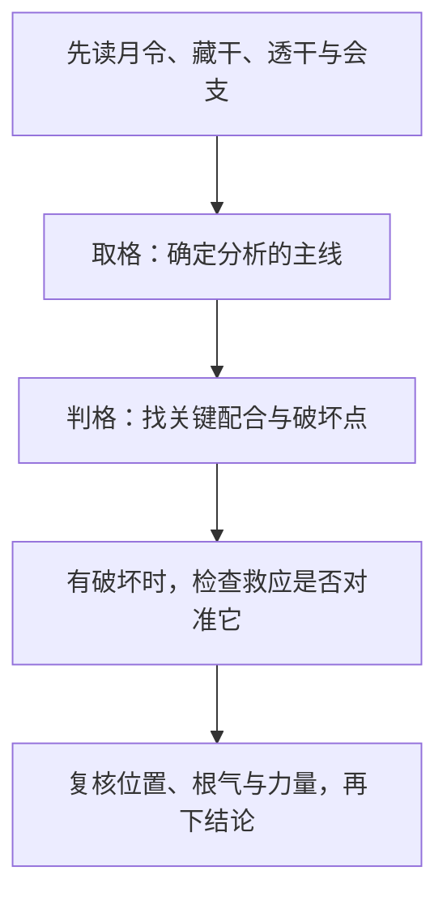

# 03-取格与判格

> 《子平真诠》第一轮通读笔记 03

第一篇问「这个字是什么十神」，第二篇问「它的作用有没有被刑冲会合改变」。到第三篇，我把问题分成两步：**取格，找出全局先围绕什么看；判格，检查围绕这个核心的配合能不能成立。**

我以前容易把两步合在一起：见到「财生官」，就想直接给它一个格名；见到「食神制杀」，就想直接判成格。复习下来，更好用的方法是先定参照，再把作用一条一条写出来。

| 层次 | 要回答的问题 | 写下什么 |
| --- | --- | --- |
| 取格 | 从月令取哪一条主线？ | 月支所藏、透干、会支，及所取的用神 |
| 判格 | 全局怎样配合这条主线？ | 谁使它成立、谁破坏它、谁能救应 |
| 复核 | 这些作用真的能发挥吗？ | 看位置、根气、力量，以及是否另有牵制 |

## 一、取格：从月令找主线

《论用神》把月令放在起点。做题时，我先问：月支藏什么，对日主分别是什么十神？哪些透出来了？有没有地支会局使原本的线索需要重看？

- **月令线索明白时，先沿它读。** 甲生酉月，酉藏辛，辛是正官，先沿正官这条主线分析。
- **月令所藏不一时，看哪条线索得到支持。** 比如甲生辰月，戊透可以先看偏财；癸透又见申、子与辰会成水局时，就要认真看印绶这条主线，不能只说「辰属土，所以一定取财」。
- **月令无常规可取时，才按书中相应的情形另寻配合。** 比如甲生寅月先辨建禄，再看四柱里能否取财、官、杀、食等。另取也要交代月令背景，不是看到某个特殊格名就倒推。

「用神变化」改变的是**从哪里取用**。比如《论用神变化》举丁生亥月为例，原先从亥中壬水看正官，若地支另见卯、未会木，则改从印看。这和「仍按官格读，但官受伤」是两种问题：一个要重看取格主线，一个是原主线下的成败。

## 二、用神与相神：主线和成格条件

主线定了，才问它需要怎样配合。书里用**顺用、逆用**给出大方向：财、官、印、食，常从生扶或保护入手；杀、伤、劫、刃，常从制约、化解或疏导入手。这是读格局的起手式，不是说正官一律有利、七杀一律有害。

[《论相神紧要》](https://www.diancangwang.cn/xuanxuewushu/03cf53eede8a/751ad9247246.html)把相神说成全局成格所依赖的关键一环。我做题时把三个问题分开：

| 概念 | 要回答的问题 | 如何辨认 |
| --- | --- | --- |
| **用神** | 这局先围绕谁来读？ | 从月令出发，结合透干、会支与全局取用，确定格局的核心。这里不是在找全局最缺的五行。 |
| **相神** | 这条取用要靠谁才能成格？ | 指出一条具体作用：是谁来生扶、制约或救应；若该作用失效，这条成格路径就站不住。 |
| **一般有利的配合** | 格已能成立，谁还可以助一把？ | 比如格局已成立且日主已有承受之力，再得到适度扶助，可以有利，但不必把它也叫相神。 |

这里把「一般喜神」当作便于比较的说法，不另设固定名册。判断时可以做个反问：**这项作用一失，是格局少了一点助力，还是原有成格路径就断了？** 问的是那条配合，不是把一个字从四柱里硬删掉；若还有另一条救应路径，也要重新检查。

### 同一组财生官，谁是用、谁是相？

《论相神紧要》把「官逢财生」和「财旺生官」并列。用前面学过的甲日对照，两边都可见己土与辛金，也都是土生金，但问题的中心不同：

| 简化条件 | 用神 | 相神及其作用 |
| --- | --- | --- |
| 甲生酉月，以辛官为主，成格依赖己财生官 | **辛正官** | **己正财**。官是要成全的一方；财在这条路径上给官提供生扶。 |
| 甲生丑月，全局确实取己财为主，辛官能制劫护财且是关键 | **己正财** | **辛正官**。财是要保全的一方；官在这条路径上管住了劫财。 |

丑月这一行特意设定「已能取己财」，不表示甲生丑月一律取财。能换的是**不同结构里的主辅角色**；己对甲仍是正财，辛对甲仍是正官。原局已经定了取用，也不能因某个字有帮助，就把它和用神随意对调。

### 原书例：壬合丁，保护酉官

原书另举甲日用酉官的例子：辛官是所取，丁伤官透出，本可伤官；若壬与丁的合确实能解除这处牵制，书中就把壬视为相神。壬对甲是偏印，但**它成为相神，是因为这里的合伤存官能成立，不是因为见了印就算相神**。此处讲合的作用，不必进一步假设丁壬已经合化为木。

这也解释了相神为什么值得单独检查：用神还在，成格所依赖的配合却可能已失效。写「用辛、相壬」只是结论；把「丁从哪里妨碍辛，壬怎样把这处妨碍解开」写全，才能接到下一节的成败救应。

## 三、成、败、救：盯住同一条作用链

我自己答过一道七杀格的题，变化只在几个字上，很适合把过程写完整。设甲日生申月，庚杀透出，先假定全局取庚杀为主；下面只比较作用，不拿这些片段当完整命造。

| 加入的条件 | 作用怎样变 | 判格时看什么 |
| --- | --- | --- |
| 有丙食神，且丙有力、日主能承受 | 丙火制庚金 | 杀得到有效制约，具备食神制杀的成格条件 |
| 又有壬偏印，且能克到丙 | 壬水克丙火，丙制庚的作用受损 | 原来的成格配合被破坏，先看食神是否真的被夺 |
| 再有戊偏财，且能制住壬 | 戊土克壬水，丙可能恢复制庚 | 若压住的是妨碍食神的壬，且丙仍有力，才可能救应 |

最值得记的是第三行的限制。**戊土也能生庚金。** 如果丙已经无力，戊只剩下生杀的作用，就不能凭「财克印」三个字判救回来。相反，若取格的起点本来是印格，印是要保护的一方，财克印又要从另一个角度读。

练习里还有财格遇劫的对照：食神可以把作用接成「比劫生食神，食神再生财」；官能有效制劫时，也可以护财。两种救法走的是不同路径。**先写出是哪一步出了问题，再找能处理那一步的配合。**

## 四、最后复核：纯杂、有情、有力

我会在「成或败」后再补三项，不急着往喜忌、行运走：

- **纯杂看配合是否协调。** 有两个十神不必然杂。食神克七杀，在需要制杀时，克得恰当也能相得；财生杀，在杀已无制时，相生反而可能增添问题。
- **有情看是否对准问题。** 需要护官时，印能不能制住伤官？需要保食时，财能不能制住夺食的印？先对准冲突，再谈救应。
- **有力看有没有条件做到。** 位置能否接上，是否通根，有无被合住或再受制。方向对了但作用发挥不出来，先记作「有救的线索」，不直接判已经得救。寒暖燥湿也可以另做一项复核，不代替月令取格。

这篇收成一句话：**取格先写明从哪里出发，判格要写得出哪条关系成、哪条关系败、又是哪条关系救。** 下一篇讲行运，才往原局里加入运干、运支，观察这几条关系发生什么变化。

### 重读线索

- [《子平真诠》馆藏扫描本](https://upload.wikimedia.org/wikipedia/commons/f/fe/NLC416-11jh010455-35296_%E5%AD%90%E5%B9%B3%E7%9C%9F%E8%A9%AE.pdf)：《论用神》《论用神成败救应》《论用神变化》《论用神纯杂》《论用神格局高低》《论相神紧要》《论杂气如何取用》。

*本文是传统命理文献的阅读笔记，局部例用于拆解书中的推理，不用于个人预测。*
