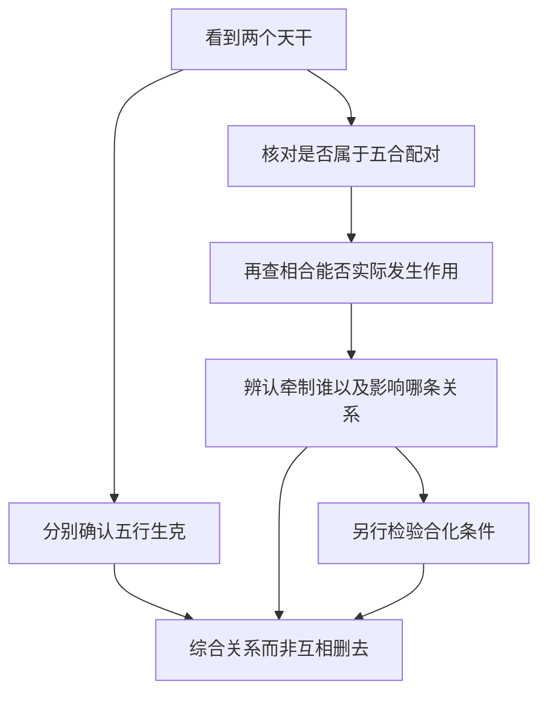
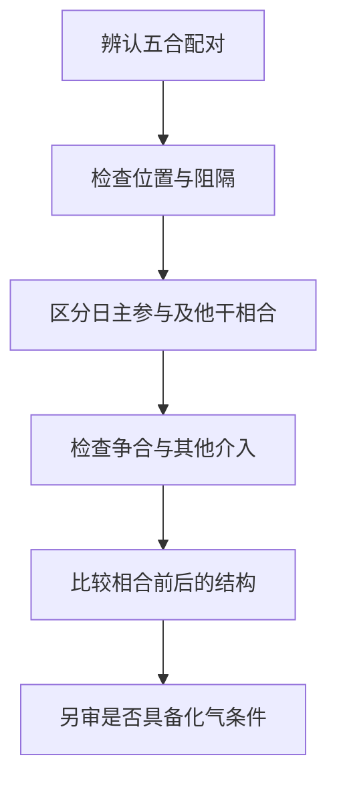

# 03 论十干配合与合而不合

> 《子平真诠》学习笔记 · 原书第 04–05 篇。篇序按原书通行本排列，不同版本编号可能不同，以篇名为准。正文为概述与推演，不作为古籍原文或评注引文。

本文讨论传统术数的内部规则，不代表经过科学验证的人生预测，不宜用于医疗、投资、婚姻等重大决策。局部例子只用于辨析概念，不含个人四柱。

天干五合只说明"哪两个干是一对"，不说明这对干一定会发生作用，更不说明一定会化气。原书用两篇处理这件事：一篇讲配合的性情，一篇专讲合而不合。合在一起读，才能把配对、相合、化气三层分开。

## 先记五合，再问合怎样起作用

天干五合的固定配对为甲己、乙庚、丙辛、丁壬、戊癸。传统分别配土、金、水、木、火。初学时可把这两组知识并列记住，但不能把"配化某行"写成"只要两干出现，就已变成某行"。配对、相合的实际作用、合化，是需要分开核查的层次。

先建立这种区分，后面的位置、阻隔、争合才有落点。看到配对时可以标注"存在五合关系"，不应立即把原有五行和十神全部删掉。

## 生克与五合为什么可以同时讨论

丙属火，辛属金，按五行说是丙火克辛金；按天干五合说，又有丙辛合。这两句话没有互相取消，因为它们使用的是不同判断层次。生克说明五行之间的作用方向，五合说明特定天干之间的配对关系，合化则进一步讨论是否满足化气条件。

因此，不能因为知道丙克辛，就断言丙辛不可能合；也不能因为记住丙辛合，就宣布克的关系从此不存在。正确做法是把已知关系列出，再考察具体配置中各关系怎样落实。若材料不足，就保留条件句，而不是强行选择一个词覆盖所有作用。

## 合而不合：先解决什么问题

认识五组配对，只完成了辨认符号。实际阅读命例时，还要问：这两个干是否能够发生所讨论的作用？作用落在谁身上？原来的结构因此得到保护，还是失去支撑？重点是把配对、相合的作用与化气分成不同层次，避免看见两个字便跳到结论。

例如丙辛属于五合配对，这是规则层面的判断；丙辛在某一组合中是否相合有力，则要看位置、阻隔及其他干的介入；是否进一步按化水讨论，又是条件更严格的问题。前一步成立，不替后一步提供自动保证。本文不以简化口诀补齐尚未核实的化气条件，也不把没有化气误读成完全没有合的影响。

## 按顺序检查，先不急着说好坏

先辨配对，再辨位置。位置较近，通常更容易直接讨论相互作用；相隔较远或中间有其他作用介入，则须解释关系怎样落实。这里没有一条适用于所有组合的距离算式，不能只凭柱位就宣布某干消失。

接着区分日主自身参与的合与其他天干之间的合。课程中关于本身之合不作合去的思路，提醒我们：日主与某十神发生相合，不能照搬第三者把这个十神合走的说法。仍要解释这种关系怎样改变日主与财、官等对象的配合，不能把自身之合理解成永远无害或必定有利。

再看有没有争合、妒合等复杂情况。出现两个同类天干争取一个对象，只能说明关系需要重新分析，并不等于两边平均分配，也不能机械地说多出来的一个必然留下。所谓合一留一，必须交代谁被牵制、谁仍能发挥作用，以及留下者是否正是结构所需。

## 局部例：合伤官，可能间接护官

设匿名教学片段以甲为日主，另见辛、丁、壬。先完成十神命名：辛金克甲木且阴阳不同，辛为正官；甲木生丁火且阴阳不同，丁为伤官；壬水生甲木且同阳，壬为偏印。然后看局部作用，丁火克辛金，是伤官克官。

若加入丁壬相合的关系，并且这个合在具体配置中能有效牵制丁，就可以讨论丁对辛的克制是否因此受到限制。这里直接参与相合的是丁与壬，辛是可能间接受到保护的一方。应说"壬合丁，可能护辛"，而不能简写成"壬把辛合住"或"辛被合所以得救"。壬相对甲仍是偏印，丁仍是伤官，不能因二者发生相合而随意改换十神名称。

例子还带着两个前提：一是辛确为当前结构所需，二是丁壬之合确能影响丁的作用。缺少其中任一前提，就不能把"丁壬合"当作自动生效的救应按钮。局部存在保护路线，也不等于已经证明完整命局成立，更不等于现实中的某件事必然转好。还要检查丁是否确被牵制、辛自身能否任用，以及壬在别处有什么作用。

## 局部例：同是合官，前提不同

设教学片段以甲为日主，辛为正官，且只讨论一位辛官承担关键作用的情况。另有丙与辛相合，如果相合确实牵制了辛，原先依赖辛的配合就可能受影响。这里必须保留两个前提：辛原本是所需对象，丙辛的作用能够落实。只凭丙辛两个字，尚不能写成官已失用。

另设一个不同片段，原先有重复或混杂的对象，而一位受到牵制后，另一位合宜对象仍能发挥作用。这时才有讨论合一留一、结构变清的空间。它不能反过来证明前一例合官也一定好，因为两例原本要解决的问题不同。一例可能损失唯一支撑，另一例可能减少干扰。

## 为什么合有时有利，有时不利

合的结果要看被牵制者原来承担什么作用。若某个天干正在破坏所需配合，它受牵制可能减轻破坏；若它正是维持结构的重要一环，被牵制则可能使原有功能受影响。合本身不是固定的吉神，也不是固定的损害。

作为对照，只设"辛官为当前所需，丙辛之合可能牵制辛"的局部前提，就不能照搬上例得出"见合必护官"。上例牵制的是克官的丁，这一例牵制的却是官星辛，直接对象已经不同。比较例子时，应先找谁被合，再找被影响的链条，不能只因两例都有"合"字就套同一个答案。

## 被合不等于消失，也不能当作算术扣分

另一种常见错误，是把"受克一次"和"被合一次"当成两笔可以直接相加的力量损失。生克与合可能相互影响，其效果并不保证独立，更没有统一数值可供相加。讨论时应描述作用状态如何改变，而不是想象每出现一个术语就从总力量里扣一格。

同理，被合不等于天干从命局消失。能否发挥原来功能、是否受到牵制、是否发生合化，是不同问题。没有核查化气条件，就不应说原来的丁或壬已经彻底变为木，更不能以这个未经证明的变化继续推导新结论。

## 自测与答案

1. 丙克辛与丙辛合是否只能选一个？答：不是，二者属于不同层次，应分别记录再查作用。
2. 甲日主例中，壬合丁可能护辛，直接被合的是谁？答：丁与壬参与合，辛是可能间接受保护者。
3. 丁壬配木，是否两干一见就已化木？答：不是，固定配对不等于合化成立。
4. 所需官星被合，与克官的伤官被合，能否一概判断为好？答：不能，必须辨认对象、原有功能及作用条件。
5. 有五合配对、有效相合、合化成功，是同一件事吗？答：不是，分别是配对资格、作用能否落实、是否满足进一步化气的条件。
6. 唯一所需辛官被丙牵制，与混杂中合一留一，能用同一句吉凶结论吗？答：不能，原来的结构与留下的对象不同。
7. 壬丁合可能保护辛官，能说辛被壬合住了吗？答：不能，直接相合的是壬丁，护辛是可能的间接结果。

---

[上一篇：论阴阳生克与阴阳生死](/knowledge/ziping/02-论阴阳生克与阴阳生死) · [下一篇：论十干得时不旺失时不弱](/knowledge/ziping/04-论十干得时不旺失时不弱) · [子平命理](/knowledge/ziping/index)
