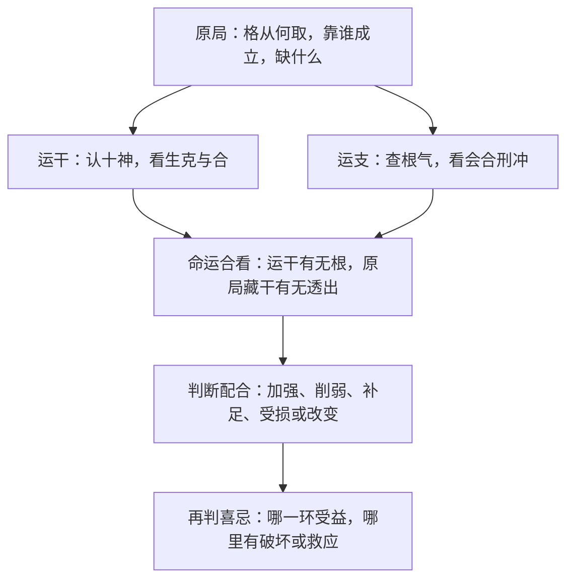

# 04-行运通则

> 《子平真诠》第一轮通读笔记 04

上一篇把「取格」和「判格」分开：先找原局的主线，再看什么使它成立，什么会破坏它，有没有救应。行运接在这一步之后。**先写清原局靠什么，再看大运到底动了哪一环。** 如果连原局靠什么都没说清楚，「喜木」「忌金」这样的结论就没法检验。

本文讲《子平真诠》如何读已经排好的大运，不讲排运、起运，也不推具体年份或事件。

## 一、行运的四步框架

| 步骤 | 先问什么 | 要写下来的东西 |
| --- | --- | --- |
| ① 定原局 | 格从哪里取？靠谁成？哪一环最容易出问题？ | 月令主线、关键配合、缺口或破口 |
| ② 分看运干、运支 | 天干加了什么生克合？地支给谁根，又和哪一支会合刑冲？ | 分别写出作用对象，不先按五行定喜忌 |
| ③ 合看命与运 | 运干有没有根？原局藏干有没有逢运透出？两边的作用有没有相互牵制？ | 把实际成立的作用接成一条线 |
| ④ 判这一步运 | 原配合只是加强或削弱，还是补齐、受损，或转成另一种配合？有无救应？ | 分开写配合怎么变，以及为什么喜或忌 |

这里的「分看」是为了识别作用，「合看」才是为了下判断。一柱大运有一干一支，都要放回原局；会局也要交代另外的支从哪里来，不能把一柱大运写成同时带来两个地支。

## 二、同是金，运干与运支做的事不同

沿用前两篇的**甲日酉月**。《论行运》的例子还给了两个前提：辛正官已经透出，而且官仍弱。少了这两个前提，就不能直接套用下面的判断。

| 行运遇到 | 书中在看什么 |
| --- | --- |
| 运支见申或酉 | 书中以补官星的根气来看，着眼点是原来那条官线得到支撑。 |
| 运干见庚 | 甲的七杀透出，与已有的辛正官同见，要查有没有官杀混杂及相应的去留。 |
| 运干见辛 | 已透的官再见一个辛，书中称为重官，不能当成又给官添了一处地支根气。 |

这个例子让我把两个问题分开：**得根是原有那个字有没有支撑；透干是天干上有谁参与配合。** 同属金，不代表效果相同。反过来，申酉也不能脱离原局就判喜，仍要看它们和其他地支会不会另起会合刑冲。参见[《论行运》](https://changxianyi.com/guji/ziping/wz-20260914/chapter-026/)和[《论喜忌支干有别》](https://changxianyi.com/guji/ziping/nlc-chengge-zhigan-text-20261004/xiji-zhigan/)。

## 三、透清：把地支所藏和运干接起来看

《论支中喜忌逢运透清》还是从甲用酉官讲起。假设原局另有**午或未，支里藏着丁**，大运又在天干见丁。对甲来说，丁仍是伤官；变化在于，原先藏在地支的丁，现在有了明处参与作用的条件，于是要检查它有没有力量克原局的辛官，以及原局是否有印能制伤护官。

这与上一节刚好是一对：

- **辛已经在天干，运支来扶它**：从干往下找根。
- **丁原先在地支，运干把它透出来**：从支往上找发用。

透清不等于「一定成格」或「一定破格」。以丁伤辛为例，没有有效的印制伤，与原局有印且确能制丁，是两种不同的判断。原局已经明透的字，也不必等到行运才论它。地支即使没有透干，也可能因会局起作用：例如午原先单见，若命与运合起来具备寅午戌，并符合会局条件，就另查火势如何影响原局。原书也把这种会局纳入「清」来论，但判断时可把两条路径分开。参见[《论支中喜忌逢运透清》](https://changxianyi.com/guji/ziping/nlc-touqing-text-20261004/zhizhong-touqing/)。

## 四、成格与变格，先描述变化，再判断喜忌

| 术语 | 这一运发生了什么 | 容易混淆的地方 |
| --- | --- | --- |
| 扶助或损伤 | 原来那条配合仍在，只是其中一环变强或变弱。 | 补根不一定就是成格，见冲也不一定就是变格。 |
| 行运成格 | 原局的取用已有方向，但关键配合未全，运把缺的一环补上。 | 补上了，还要看是否被原局已有的字牵制。 |
| 行运变格 | 新的作用介入，改变了这一运里原来的配合。 | 不必把「变格」一律读成坏事，也不是用运支重新当出生月令。 |
| 受损与救应 | 运触及原局赖以成立的一环，同时也可能有另一环化解。 | 先指出谁被伤，再指出谁能救，不能只说「见吉神」。 |

用原书**丁日辰月、壬透为官**的例子对照：辰若与原局已有的一支、运中来到的另一支凑齐申子辰水局，可以按书中「由运补足」的方向读。反过来，运透辰中戊土，戊为丁的伤官，会干扰原来的用官配合；如果原局有甲且能制戊，则仍有护官的路径。这就是书中「变格而不忌」的例子之一。也有反面：壬日午月，运透己官，看起来补了官，但原局已有甲能制己，不能只凭「补齐」就判喜。参见[《论行运成格变格》](https://changxianyi.com/guji/ziping/nlc-chengge-zhigan-text-20261004/xingyun-chengge/)。

## 五、复盘时只写四句话

1. 原局从哪里取格，靠哪条配合？
2. 运干动了谁，运支动了谁？
3. 哪条作用成立，有没有根、合冲、透清或救应？
4. 这一运改变的是力量，还是配合本身？为什么？

如果只能写「金是喜神，所以金运好」，就回到第二句，把「金」换成具体干支，再说清它作用在哪个字上。下一篇读各格取运时，就用这四句话对比同一个格的不同原局：各自需要补的，到底是哪一环？

> 本文是传统术数文本的读书笔记。篇名依原书相关章节，原文可对照[国图藏影印本，第 56–62 页](https://upload.wikimedia.org/wikipedia/commons/f/fe/NLC416-11jh010455-35296_%E5%AD%90%E5%B9%B3%E7%9C%9F%E8%A9%AE.pdf#page=56)。
