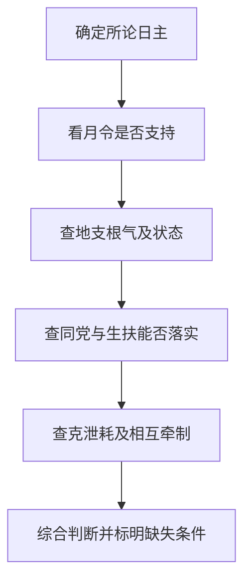

# 04 论十干得时不旺失时不弱

> 《子平真诠》学习笔记 · 原书第 06 篇。篇序按原书通行本排列，不同版本编号可能不同，以篇名为准。正文为概述与推演，不作为古籍原文或评注引文。

本文讨论传统术数的内部规则，不代表经过科学验证的人生预测，不宜用于医疗、投资、婚姻等重大决策。局部例子只用于辨析概念，不含个人四柱。

## 月令重要，但不是全部答案

本篇针对两个常见捷径：生在本行当令的季节就直接判旺，生在不当令的季节就直接判弱。传统强弱分析确实重视月令，但还要考察地支根气、同党帮扶以及克泄耗的配合。得时不旺、失时不弱，强调的是季节与最终力量判断之间仍有推理步骤，并非否定月令。

这里讨论的强弱是术数体系内部的关系概念，不是对人的体能、性格或现实能力进行测量。学习时应先把每条判断的依据列出来，而不是拿一个强弱标签解释所有生活经验。

## 得时、得地、得势分开记录

得时，是月令对所论天干之气有支持。它回答季节背景的问题，不直接回答全局还有多少克泄耗。得地，是在地支中有根气可据，须检查根在哪个支、属于什么层次，以及相关支的状态。得势，是整体同类与生扶力量形成支持，不能把天干上出现几个相同字直接当作结论。

通根与帮扶也不相同。天干出现比劫，是同类关系；地支有相应根气，是根基问题。有帮扶不代表根气充足，有根也不代表完全不受制约。乙木见卯与见辰均可讨论根，但卯中的木气与辰所藏乙木不能等量处理。只写两个例子都含一个木字，就丢掉了根气层次。

得势还须区分帮扶是否能实际发挥作用。同党若本身无力、受到牵制，或同时卷入其他生克关系，名义上的支持就不能全部照收。得时、得地、得势是便于分项观察的框架，三者并非互不相关的三个加分格。

## 局部例一：得令有根，仍不能停止检查

设甲木生于卯月。月支已经是卯，因此不能一面说甲生卯月，一面又说地支完全没有木根。这个片段至少支持得令、有根的判断。接下来仍要查看全局：是否有较多火来泄木，土使木有所耗，金来克木？这些关系各自有没有根气，作用是否能够落实？

如果只给出甲与卯，最稳妥的结论是得到季节支持且有根，而不是已经完成身强身弱的总判。即使另补几个金火土字，也不能立即反转为弱，因为所补之气的力量和位置尚未说明。例子的意义在于保留分析步骤，而不是制造一个信息不足却结论响亮的命例。

## 局部例二：失令不等于没有支撑

设甲木生于酉月，另外给出寅卯根，并有甲乙壬癸等支持条件。酉月对甲的季节背景不能忽略，但它并没有删除其他根气与生扶。这个片段足以反驳只凭酉月就判弱的做法，尚不足以证明甲一定很强。

下一步要检查寅卯根的具体状态，甲乙帮扶是否有效，壬癸能否生木，以及金与其他克泄耗如何配合。若这些支持确能发挥作用，失时仍可能得地得势；若支持受到明显牵制，则应相应修正。关键是逐项解释，不是用失令两字覆盖所有证据。

## 反例：三个帮手不必胜过一个对手

数出三个木、一个金，便说木一定占优，是把字数误当力量。三个木可能季节不利、缺乏根气；一个金可能得到月令和根气支持。反过来，一个得令有根的木，也不能仅因数量少就判弱。这里不另立数量绝对无用的规则，数量只是信息之一，必须与质量和作用一起看。

另一个误区是把合冲直接翻译成根被拔掉。根所在之支发生关系后，究竟怎样影响木气，需要结合具体结构说明，不能仅凭关系名称删除根。这也为下一篇分析刑冲会合留下接口。

## 自测与答案

1. 甲生卯月，能说得令但全无木根吗？答：不能，月支卯本身就是根，仍须另查根的状态与全局关系。
2. 甲生酉月，另有寅卯及甲乙壬癸，为什么不能直接判弱？答：失时不排除得地得势，但支持是否有效仍须复核。
3. 乙见卯与乙见辰是否同样有一个根，因此完全等强？答：不是，根气层次及支的状态不同，不能用计数代替分析。

---

[上一篇：论十干配合与合而不合](/knowledge/ziping/03-论十干配合与合而不合) · [下一篇：论刑冲会合解法](/knowledge/ziping/05-论刑冲会合解法) · [子平命理](/knowledge/ziping/index)
