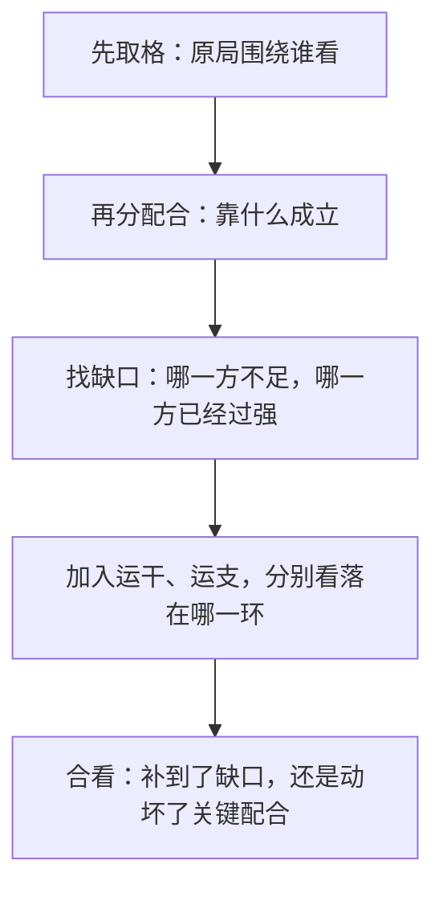

# 05-各格精读与取运

> 《子平真诠》第一轮通读笔记 05

读到各格取运，我一开始想给每个格做一张「喜什么、忌什么」的表。做到七杀格才发现，这张表如果只按格名分行，第一条就会写错：同是食神制杀，书中有时要助食，有时反而要助杀。真正需要分开的，是**同一格里不同的成格配合，以及这套配合当前缺什么**。

这是前四篇的合练：先认十神和月令，再查干支作用，找出用神、相神与成败救应，最后看大运动了哪一环。

## 一、八类取运先看配合

这张表用来找对应的原书段落。每行只摘一两条读法，不是见到该格就照着判运。

| 格类 | 先辨哪种配合 | 读取运时问什么 |
| --- | --- | --- |
| [正官](https://changxianyi.com/guji/ziping/wz-20260914/chapter-033/) | 财生官、官佩印、带伤而赖印制 | 是官轻要补官，还是身轻要扶身？若全靠印制伤护官，就要查财会不会伤到这个印。 |
| [财](https://changxianyi.com/guji/ziping/wz-20260914/chapter-035/) | 财旺生官、食神生财、财格佩印 | 同是食神生财，财食重而身轻，先看能否扶身；身重而财食轻，才看运能否助财食。 |
| [印绶](https://changxianyi.com/guji/ziping/wz-20260914/chapter-037/) | 印用官、印用杀、印遇财 | 官露印重时，书中有财运反可用的情形；若正靠印化杀，财克印就可能拆掉关键配合。 |
| [食神](https://changxianyi.com/guji/ziping/wz-20260914/chapter-039/) | 食神生财，或舍食而改走杀印配合 | 前者要分财食与日主轻重；后者既改靠印，就要留意财是否破印。 |
| [七杀（偏官）](https://changxianyi.com/guji/ziping/nlc-continuation-text-review-20261005/pianguan-quyun/) | 食神制杀、印化杀、财去印存食 | 先看杀靠谁处理，再看是杀重、食重，还是杀食相当而日主根轻。 |
| [伤官](https://changxianyi.com/guji/ziping/wz-20260914/chapter-043/) | 伤官生财、伤官佩印、财印兼见 | 用财时分财旺身轻还是身强财浅；佩印时，先查财会不会伤到赖以成格的印。 |
| [阳刃](https://changxianyi.com/guji/ziping/wz-20260914/chapter-045/) | 用官或用杀制刃；官杀并见要辨去留 | 杀不足时可看助杀；杀已太重，就不能因有刃仍一味加强杀，书中转看扶身、印绶等。 |
| [建禄、月劫](https://changxianyi.com/guji/ziping/wz-20260914/chapter-047/) | 从四柱另取官、财、杀或食伤；兼见官杀时要辨去留 | 同是禄劫，用官就检查官的根与护官条件；用财而带食伤，则先分财食太重还是太轻。 |

最容易混在一起的是**格名**和**作用关系**。财格可以靠食神生财，食神格也可以生财，两处都写得出「食→财」，但取格的出发点不同。下一步仍要回到原局：谁是主线，谁让它成立，哪一方不足？

## 二、七杀格：同一条制杀链，三种相反的取运判断

沿用第三篇的练习：**甲日申月，假定庚七杀为用，原局靠丙食神制庚。** 下面是同一结构的三个局部对照，不是三个完整命例。

| 原局的不同条件 | 要解决的问题 | 《论偏官取运》的方向 |
| --- | --- | --- |
| 杀重，食轻 | 丙制庚的力量不够 | **助食**，加强制杀的一方。 |
| 杀轻，食重 | 庚已弱，丙制得过头 | **助杀**，不再加重食神的制约。 |
| 杀食大致相当，日主根轻 | 制杀并不是当前缺口，甲自身根气不足 | **助身**；仍须查扶身方式会不会同时夺食。 |

第三行尤其容易误读。「助身」讲的是要解决的问题，并不是见印就放行。第三篇已经试过：壬为甲的偏印，既能生甲，也能克丙；若壬夺食使庚失制，就不能只记「壬水生木」这一条。

### 同是财，可能拆掉配合，也可能救回配合

还用这组字。戊土对甲是偏财，**一边能生庚金，另一边能制壬水**。到底哪一边主事，要先看原局：

- **丙还在制杀，杀已偏重**：如果戊主要助庚，可能让原有制杀不足，不能因为「财」是好听的名字就判喜。
- **壬正在夺食，丙仍有根气**：如果戊有力制住壬，且丙因此能恢复制庚，财就可能是救应。还要复核土生金会不会反过来把庚助得太过。
- **原局主要靠印化杀**：此时印在保全格局，财若伤印，就不是上一条的「去印存食」。同样是财克印，作用的方向完全不同。

所以我读取运时更愿意写「财制哪一个印、保住哪一个食神」，而不是笼统地写「七杀格喜财」或「七杀格忌财」。这也是[《论偏官取运》](https://changxianyi.com/guji/ziping/nlc-continuation-text-review-20261005/pianguan-quyun/)把不同配合分段讲的原因。

## 三、杂格：先确认能不能取，再谈顺着什么走

《论杂格》把另取外格放在常规取用不合适时讨论。正格有点不顺，不等于可以改叫从格；一眼看到五合，也不等于化气成立。通读最后我想分清的是四种不同的判断：

| 读书时的分类 | 先检查成格条件 | 确认成立后再读取运 |
| --- | --- | --- |
| **专旺**（原书例为取一方秀气） | 是一方之气得时成势，还是仅日主较旺？ | 先看是否延续那一方之势。吴相公木旺例中，原书还允许财、食，不能把这个例子或后附通则套给所有专旺局。 |
| **从财** | 财势偏于一方，日主无足以自立的根气，印比等不能把它拉回常局。 | 原书该例看食伤生财、财势得助；若大运使原先不能自立的一方重新有了支撑，要另查原配合是否还能从。 |
| **从杀** | 杀势成局，日主无根可立；若已有有效制杀或化杀，先考虑常格配合。 | 原书该例看财官顺杀势，忌食伤制杀。和「食轻要助食」的普通七杀格恰好不同。 |
| **化气** | 先证明合有化的条件，再核化出的五行是否得时、有支局支持。 | 按化出之气及全局配合来读。原书丁壬化木例重木得时成势；不是凡有丁壬，或凡逢木运，就按化气格判断。 |

原书的**李侍郎例**是「乙酉、乙酉、乙酉、甲申」。干上虽然见甲、乙，原书仍着眼于地支一派申酉、日主无木根，据此作从杀来读。这例子提醒我：所谓「有扶身」不能只数天干上有几个同类字，要核它们有没有根、能不能真的形成支撑。也不要反过来把这个例子当成所有从杀的判法。参见[《论杂格》原文](https://changxianyi.com/guji/ziping/nlc-continuation-text-review-20261005/zage/)。

版本也需要记一笔：馆藏世界图书馆本的主体收尾是《论杂格》，篇内已经谈到部分杂格取运；有的徐乐吾评注本在后面另列《附论杂格取运》。比如原书对吴相公这个木旺例允许财、食，而附论在曲直仁寿的一般说法中对财运有不同提醒。前者是具体命例的判断，后者是附论的概括，不宜抹掉出处，合并成一句统一喜忌。可对读[馆藏影印本](https://upload.wikimedia.org/wikipedia/commons/f/fe/NLC416-11jh010455-35296_%E5%AD%90%E5%B9%B3%E7%9C%9F%E8%A9%AE.pdf#page=93)和[《附论杂格取运》](https://luckclub.cn/bazi/002/050/)。

## 四、通读以后，怎样复盘一个命例

我最后只留五行笔记：

1. **十神与月令**：以哪个日干为参照，月支里有哪些取用线索？
2. **刑冲会合**：哪些合、冲、会确实改变了原先的关系？
3. **取格与判格**：用神是什么，靠谁成格，破口和救应在哪里？
4. **行运通则**：运干、运支分别动了什么，合起来又怎样？
5. **各格取运**：在这个格的具体配合里，这一步是补了缺口，还是损伤了关键一环？

如果第五行只剩一个喜忌名单，说明前面的依据还没写出来。第一轮通读对我最有用的，是学会把一个格名展开成一条能逐步复核的推理。

*本文是传统术数文献的读书笔记，以原书的判断方式为讨论对象，不作个人预测。*
