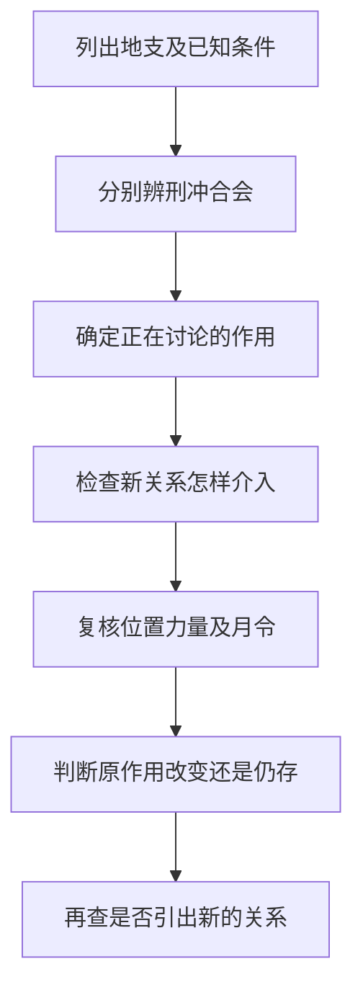

# 05 论刑冲会合解法

> 《子平真诠》学习笔记 · 原书第 07 篇。篇序按原书通行本排列，不同版本编号可能不同，以篇名为准。正文为概述与推演，不作为古籍原文或评注引文。

本文讨论传统术数的内部规则，不代表经过科学验证的人生预测，不宜用于医疗、投资、婚姻等重大决策。局部例子只用于辨析概念，不含个人四柱。

## 先辨关系，再讨论解除

地支之间可以同时存在多种关系。本篇关心的不是背出某个名称便判断吉凶，而是观察：原来哪条关系在起作用，另一关系加入后改变了什么，这个改变能否落实。所谓解法，必须有具体要解除的作用，不能把看见合字直接等同于所有冲刑都消失。

六冲、三刑、六合、三合、三会各有自己的关系规则。六冲不是三刑，讨论冲时采用的位置考量，也不能不加说明地照搬为三刑的统一距离公式。遇到复杂例子，先分别列出关系，再考察它们怎样相互牵制，比抢着选一个最强名称更可靠。

## 三合与三会：同属聚气，构成不同

三合按传统生旺墓联系来组织：亥卯未木、寅午戌火、巳酉丑金、申子辰水。三会按方位与连续季节来组织：寅卯辰木、巳午未火、申酉戌金、亥子丑水。两者不能因为同样涉及三个支，就混称三合或三会。

三支齐全，首先表示相应结构出现，不等于其他五行和藏气被全部删除，也不自动证明已经彻底化局。还要回看月令、透干及其他作用。将结构出现与化局完成分开，才能解释为何相同三个字在不同配置中不能直接得到相同结论。

课程也讨论了半合与拱合，但其成立与强度判断存在流派差异。教学上可以把含旺支的两支组合与缺旺支的两端联系分别识别，例如亥卯与亥未所讨论的条件不同；不能把未出现的卯当作已经实有，更不能未经说明就把二支按完整三合处理。

## 局部例一：合出现，不等于冲自动消失

设局部片段中有子午冲，另见丑，子丑又构成六合配对。此时能够确定的是同一个子进入了两组关系，不能直接写成有子丑合，所以子午冲已经解除。

需要继续问：丑与子的位置及作用条件如何？子丑之合是否足以改变子对午的作用？午及其他支又受到什么支持或牵制？如果只给这三个支，不足以给出最终解冲结论。这个例子训练的是提出必要问题，而非给六合固定高于六冲的排名。

再把观察范围扩展到其他支，可能发现原先参与解冲的支又被另一关系牵制。此时原作用可能重新显露，也可能引出另一处刑冲。因此，解了某一条关系不表示全局从此没有问题，仍须沿实际作用继续检查。

## 局部例二：三合金，不能直接叫正官

设甲为日主，地支出现巳酉丑。先要认清巳是地支的巳，不是天干的己。就五行大类而言，金克木，金气对甲属于官杀范围；要进一步落实正官还是七杀，还须辨庚辛等具体阴阳关系。

因此，巳酉丑出现可以进入三合金的结构分析，却不能把整组一概命名为正官，更不能直接推到官格成立。月令背景、透干与实际配合仍是后续问题。这里既要防止把地支写错，也要防止从五行大类越级跳到完整格局。

## 反例：重复的支不是自动抵消键

篇章例子中有关二卯不刑一子的说法，只应放回该例语境理解。它不等于任意两个相同地支都能抵消一条刑，更不能推广成数量多的一方必定不受影响。遇到重复支，依旧要说明参与关系的是谁、作用如何改变。

同样，没有三合永远压过六合的固定优先级。某条关系被牵制，描述的是它的作用受限，不等于参与地支的五行力量必然减少；把作用关系与力量混写，反而会使后续推演互相矛盾。

## 自测与答案

1. 寅卯辰是三合木吗？答：是三会木；亥卯未才是三合木。
2. 子午冲另见丑，可以直接宣布解冲吗？答：不能，要查子丑合是否实际改变了冲的作用。
3. 巳酉丑对甲是否全属正官？答：只能先说官杀大类，具体正偏仍看阴阳，不能据此直接定官格。

---

[上一篇：论十干得时不旺失时不弱](/knowledge/ziping/04-论十干得时不旺失时不弱) · [下一篇：论用神](/knowledge/ziping/06-论用神) · [子平命理](/knowledge/ziping/index)
