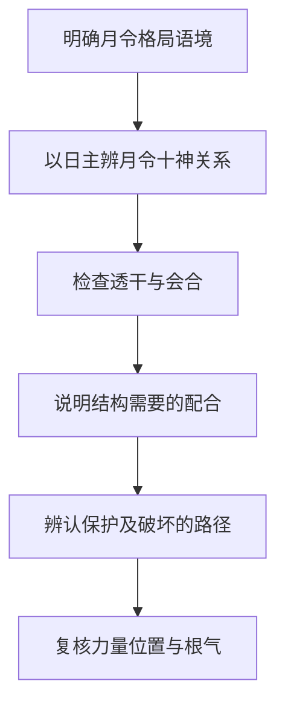
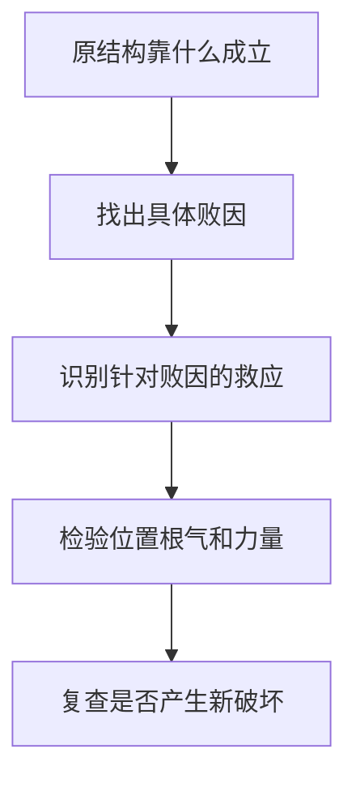
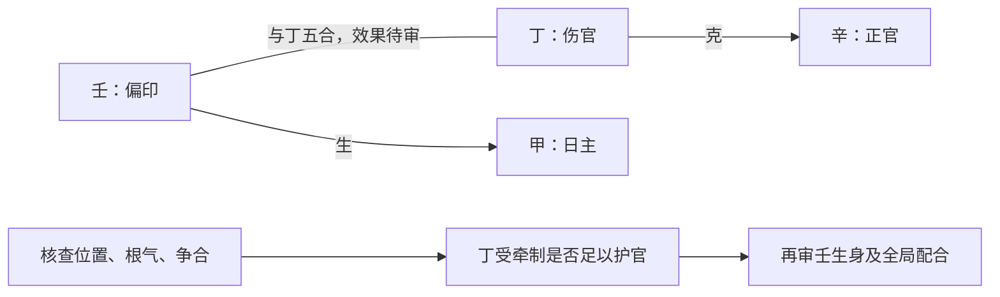
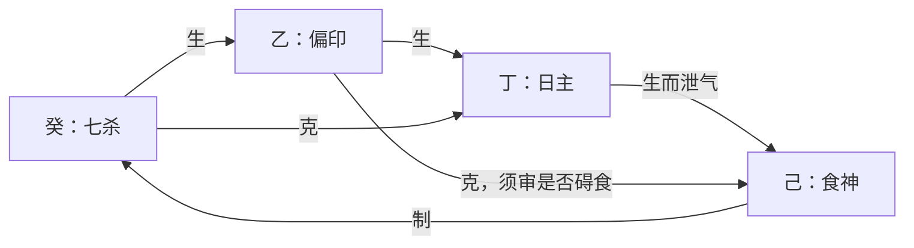
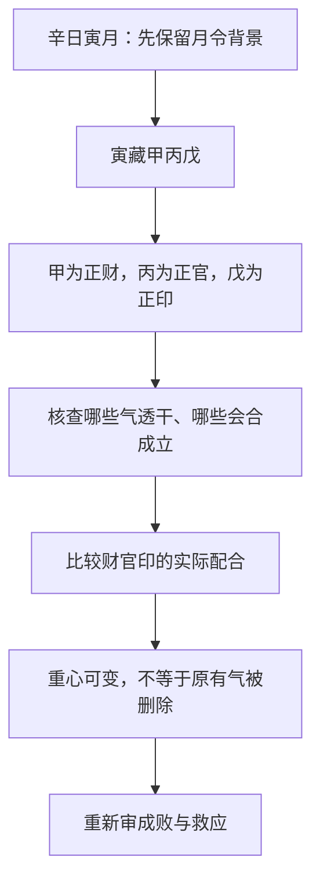
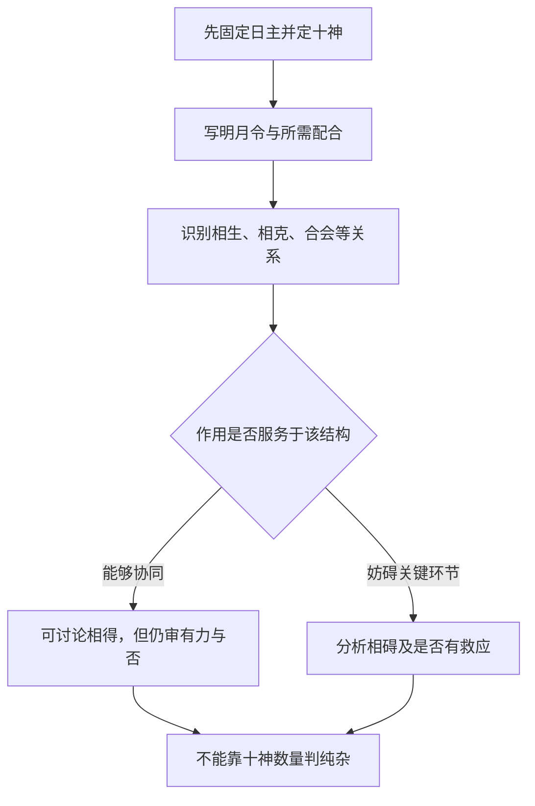

# 06 论用神

> 《子平真诠》学习笔记 · 原书第 08–11 篇。篇序按原书通行本排列，不同版本编号可能不同，以篇名为准。正文为概述与推演，不作为古籍原文或评注引文。

本文讨论传统术数的内部规则，不代表经过科学验证的人生预测，不宜用于医疗、投资、婚姻等重大决策。局部例子只用于辨析概念，不含个人四柱。

用神是全书最集中的一组问题，原书连用四篇展开：先说明用神从哪里取（月令），再判断所取之路能否成立（成败救应），接着看透干会合如何调整重心（变化），最后分辨调整之后的几种作用能否相得（纯杂）。四个问题是递进关系——取用给出起点，成败检验路径，变化解释主次，纯杂比较配合质量。任何一层都不能替代另一层。

## 使用用神一词，先交代语境

用神在不同命理讨论中并不总指同一件事。若不先说明语境，很容易一边说用神来自月令，一边又因身弱把印比叫作用神，最后误以为两条判断互相矛盾。本系列依本书课程的月令格局思路展开：先从日主与月令的关系识别结构，再检查透干、会合与其他配合。

后世扶抑语境常用有利于平衡强弱的五行来谈用神，例如身弱时讨论印比。这类问题关心什么力量可能有所帮助，与月令格局分析的起点不同。两者可以相关，但不能在同一段推理中悄悄换义。阅读时，最好先写明自己此刻回答的是格局从何处立论，还是力量如何配合。

## 从月令出发，不是只看一个字

日主提供十神参照，月令提供取用的关键背景。先辨月令所含之气与日主的关系，再看哪些气透出、哪些会合改变了配合，最后观察结构如何运作。月令有时藏气不一，因此从月令取用不等于永远只用一个表面名称概括全局。

透干让某种气在天干层面进入讨论，但透出不等于已经有力；会合使关系改变，也不自动删除月令原有的气。学习者需要把月令、透干与会合连接起来，既不能绕开月令只找一个好听的十神，也不能立了格名后便不再检查实际条件。

## 有官，不一定就是官格

设甲生酉月，酉中辛金对甲为正官。若再见辛透，便可以从官格背景出发，讨论官如何得到配合，以及是否受到伤官等作用影响。这只是分析入口，不能把官格背景写成官格已经成就。

另设甲生寅月，天干也见辛。辛对甲仍是正官，但月令背景已经不同：这里应按建禄用官的思路讨论，不能因为天干看见辛就与前例一概称为官格。两例可以有相似的生克链，格局归属却不因此相同。

这个对照说明，十神名称回答某干相对日主是什么；格局名称还要回答月令怎样提供结构背景；成败判断则继续问配合是否成立。三个层次都需要，不宜用其中一个替代其他两个。

## 顺用与逆用，是处理原则

传统课程常把财官印食放在顺用的讨论中，把杀伤劫刃放在逆用的讨论中。顺用强调使相应作用获得合宜的生扶和保护，逆用强调通过制约、转化等配合处理其可能造成的问题。这些是体系内部的处理原则，不是给人贴善恶标签。

以甲日主、辛官、丁伤官的片段为例，若辛正承担所需功能，丁克辛便可能成为要处理的问题。若另有壬丁合且条件有效，可以讨论牵制丁而间接护辛。这是在说明为什么要保护所需功能，不是在说凡印皆好、凡伤官皆坏。

反过来，当七杀需要食神制约时，食神的克制可能正是配合所需。不能因为看到克就认作破坏，也不能因为看到相生就认作帮助。顺逆最终要落到具体结构上，而不是停留在十神的名声上。

## 反例：五行平均不是唯一目标

假设某局印已经偏重，仍因印常被列入顺用便继续增加印，未必有助于原来的配合。或者一见身弱就宣布只能用印比，也会跳过月令结构与各作用的具体条件。强弱分析有价值，但不能把整个体系改写成哪里少就补哪里。

同样，强调月令取用，也不能说本书完全不看力量。一个名义上负责制杀的食神，如果自身无力或受到牵制，便不能只凭名称证明制杀有效。格局给出应检查的作用方向，力量、位置和根气帮助检验这些作用能否发生。

## 成与败：先拆开四个判断层次

取用之后要回答：原先靠什么成格？什么破坏它？谁处理破坏？这种处理是否真正有效？成格、败格、带忌、救应是不同层次。

"成"不是给某个十神贴上吉的标签，而是说明一组配合为何能承担本来的取用任务。"败"则必须指出具体哪一条关系遭到破坏。若只说"有伤官所以败"，还没有回答伤官损害了谁、被损害者是否正是关键环节。所谓成中带忌，是已经看见可成立的路径，又发现牵制它的因素；不能因为有一条好关系，就不再检查其他部分。

救应也有两个层次。第一层是逻辑上有针对性，例如伤官损官而有人牵制伤官；第二层是这种牵制在全局中是否能发挥作用。后一层要回到位置、根气、强弱与争合等条件。下文的箭头只表示待检验的作用关系，不表示已经完成吉凶判断，更不对应现实中的必然事件。

### 各格的成与败

**官格与建禄用官。** 甲日酉月以辛官为核心，丁伤官克辛；壬印合丁，可能护官。与甲日寅月建禄用辛官有相同生克链，但月令格局归属不同。丙日巳月的迁移练习：癸为正官，己为伤官，甲为偏印；甲己合可能护癸，但甲也生丙，不能断定全局只有好处。

**财逢劫。** 可以用食伤引化比劫并生财，或官星制劫护财。两条救法作用机制不同，不能背成"见某吉神必救"。

**印逢财。** 印轻受财破坏时，劫财制财或合财可能存印；印过旺而需要财制印时，劫财夺财反可能损坏配合。同一财星克印既可能是败因，也可能是成格手段。

**食神逢枭。** 这里分清两条路径：生财以制枭护食，保留食神的成格路径；弃食就杀则改变取用配合，不能说两者都只是增加同一个吉神。这里只概述这一取用思路，不把"弃食就杀"扩展成任意换格规则。

**杀逢食制、印来护杀。** 当食神正承担制杀功能，印制食可能破坏这一功能；有财制印、存食时可讨论救应。反过来，阳刃需要官杀制刃时，食伤制官杀可能变成破坏，印制食伤反而可能护官杀。关键是先认出要维护的结构。

**伤官生财与财生杀。** 财可承接伤官，但财又生杀，可能造成新问题；伤官本身也能制杀，不能直接说"有财生杀就七杀无制"。看双方力量与作用是否落实。

**建禄用财、带杀而杀被合。** 甲日寅月，己正财、庚七杀、乙劫财。己生庚，庚克甲；乙庚合若有效牵制庚，可讨论救应，但乙也克己，不能只看合杀忽略夺财。

建禄不等于自动成格，用财仍须处理比劫夺财与食伤生财的条件。甲生丙、丙生己，是泄身生财；丙克庚是食神制杀，两条机制不能混为一谈。

**印格的四种配合。** 四种已整理路径：印轻逢杀；官印双全；身印两旺用食伤泄气；印多逢财且力量配合合宜。不能一律"印越旺越好"。

关键疑问：印重时为何透官和透杀的判断不同？可旁参后篇《论印绶》解释：正官不只生印，也有自身取用功能；七杀重在制化。身强印重透杀不等于永远不可用，若兼有力食伤制杀、泄身，须重判。

### 把"印来护官"画成作用链

以匿名局部配置"甲日、酉月，另见辛、丁、壬"为例，先分别确定辛是正官、丁是伤官、壬是偏印。不能把壬误写成正印，也不能因为讨论丁壬合而把日主参照换成丁。

读图的顺序是：先认出官受到的损害，再看丁壬合是否能牵制丁，最后检查壬自身引入的其他作用。壬没有直接"合住辛"，图中也不需要先宣布丁壬已经化木。合与化是两道不同的判断。如果丁壬虽有配对而实际作用受阻，只能记为"有潜在救应"，不能写"官已救成"。

换成甲日寅月而仍用辛官，部分作用链可以沿用，但格局背景改为建禄用官。这个对照说明：生克机制可以迁移，格名不能连同答案机械搬运。

### 同一个财，为什么一处救、一处破

比较两种互不混用的前提。情形甲：印本来偏轻，正负责承接官杀或生身，财来克印又生杀，原来的承接链可能受损。情形乙：身印两旺，正需要适量财来约束过重的印，财反而是配合的一环。两者表面上都是"财克印"，结论却不能相同。

因此遇到劫财制财，也不能马上喊"存印得救"。在情形甲，牵制财可能保护所需的印；在情形乙，它可能拿掉原本需要的制约。必须先写清初始条件，才有资格讨论救应。即使在情形甲，劫财本身也可能干扰其他财星作用，需要继续复核。

### 印格补充例：一条干同时有两种作用

丁日见乙、癸、己，乙为偏印，癸为七杀，己为食神。癸水既可生乙木，也可克丁火；己土既承接丁火之生，也能制癸水。这不是说每条关系都能同等强度发挥，而是说不能凭"癸生乙"便把"癸克丁"从图上删除。

如果讨论身强印重而兼食神制杀，己的泄身与制杀是两种作用；但乙克己也不能忽略。这个例子只能帮助列出待审关系，没有完整位置与根气，不能据图断定一定成格。旁参后篇《论印绶》用于理解本节疑点，并不表示后篇已经逐章学习完毕。

### 小结

有救应关系不等于有效救应；有效保护一环也不保证整个命局成立。力量、位置、根气与合化条件仍需审查。

## 变化：取用重心的调整

成败救应评估某条路径是否成立；变化再问：最初从月令识别的线索，会不会因透干和会合而出现不同的组织方式？月令并不总能压缩成一个单独天干，藏气之间本就有不同的十神关系，实际透出什么、怎样配合，会影响哪一条关系成为分析中心。

这里的"变"不是把月支换掉，也不是把原本未透出的藏气视为不存在。更不能理解为看到命局有某个天干，就随意把月令格局改名。先保留月令背景，再说明新出现的关系如何改变主次，才是可复核的推演。变化不意味着原来的气被删掉。

### 一例三读：辛日寅月

这个例子只保留教学所需的日主与月令，不对应任何人的完整四柱。辛为阴金，寅中甲木对辛是正财，丙火对辛是正官，戊土对辛是正印。先把这三项算清，后面的讨论才不会把不同参照混在一起。

| 局部观察 | 可以提出的分析线索 | 仍不能省去的检查 |
| --- | --- | --- |
| 重点观察甲透 | 财的作用在天干显现 | 财是否有力、日主能否承接、是否受劫 |
| 重点观察丙透 | 官的作用在天干显现 | 官是否受伤、财官印如何配合 |
| 甲丙并透 | 可讨论财与官协同、财格兼官 | 财生官是否合宜，丙辛合等关系是否影响作用 |

这里列的是三种观察条件，而不是三份可以直接定格断事的完整命局。尤其丙与辛有五合配对，不能一面强调条件分析，一面在此处又忽略日主自身参与合的情形。是否受牵、怎样理解本身之合，需要回到"论十干配合与合而不合"去查，不能因为看到"财生官"便宣布全部问题消失。

### 三个"变"的说法如何区分

**变而善**：变化后的配合，更能承担该体系下所需的任务。所谓善是结构上的相宜，不是某个十神名称自带好结局。比如新显现的关系能够衔接已有作用，而没有破坏关键环节，才有继续讨论的依据。

**变而不善**：新增或转强的关系妨碍原有配合，或者使原先次要的问题成为主要矛盾。不能把它机械简化为"透杀就是不善"；七杀若得适当制化，仍需按实际条件重判。

**变而不失本格**：取用的具体配合发生变化，但原来的月令线索仍发挥作用。辛日寅月甲丙并透，可以从财官关系讨论兼用，不必把财的线索整段删去。这个说法提醒我们，变化与连续性可以并存。

这三个表述是分析结果，不是起步时直接套用的标签。要先展示推理链，再使用术语。只写"此为变而善"，却没有说明什么变了、原格保留什么、受益的是哪一环，读者仍然无法检验。

### 与成败、纯杂的关系

变化不是否定月令取用，而是展开月令藏气与实际配合之间的关系。与成败救应相比，那里评估某条路径是否成立，这里讨论这条路径为何成为当前的取用重心；与纯杂相比，变化回答"主次如何调整"，纯杂回答"调整后的几种作用能否相得"。三个问题相关，但不能用一个词替代另外两个。

## 纯杂：从"有几种"改问"能否协同"

纯杂讨论的不是符号清单整不整齐，而是各项作用是否围绕所需结构相互配合。同一组五行关系，在不同的月令与取用前提下可能承担不同功能。因此"相生就是纯""相克就是杂"都过早：我们还不知道所生的是需要的对象，还是正在造成问题的对象。

更准确的说法不是"纯杂与生克无关"，而是"纯杂不由生克字面直接决定"。仍要靠生克关系解释为何相得或相碍，只是不能停在箭头名称这一层。判断纯杂也不能代替强弱；结构方向合宜而作用不足，仍是需要另行处理的问题。

### 三组组合比较

辛日寅月甲丙并透，财生官；癸日未月乙己并透，乙食神制己七杀；戊日申月庚壬并透，庚食神生壬偏财。各例都先判断十神，再看组合所需。

**例一：辛日寅月，甲丙并透。** 先定十神：甲为正财，丙为正官。木生火，局部关系为财生官。在官的作用确为所需、财能承接而没有关键干扰的前提下，可以讨论相得，而不是因为出现财、官两个名称就判杂。

但这里不是拿到两个干便直接判纯。丙辛存在五合配对，辛日主参与其中；合怎样影响官的作用，须用"论十干配合与合而不合"的条件继续审查。财官各有多少力量、是否另有伤官干扰，也都尚未给出。这个例子展示"为什么可能相得"，不提供完整成格结论。

**例二：癸日未月，乙己并透。** 癸是阴水，乙为同阴的木，是食神；己为同阴的土，克癸，是七杀。乙木克己土，形式上是相克。如果此处七杀需要制约，而食神确能担任这个任务，食神制杀反可能是相得的配合。

它与财生官的箭头方向不同，但两者都可能服务于各自结构。反过来，若食神已经制杀过度，或本来需要的是另一条承接路径，就不能照搬"食制杀必纯"。所谓相得含有"适合此局需要"的限定，而不只是一张生克口诀表。

**例三：戊日申月，庚壬并透。** 戊为阳土，庚为食神，壬为偏财，庚金生壬水。这里可以从食神生财理解衔接：食神所泄之气进一步流向财。但必须检验日主、食神与财之间是否承接得住，不能把持续泄耗本身当成无条件的好事。

三例只展示局部关系，不公开个人命盘，也不对现实财富、职业或婚姻作判断。它们的共同点不在"全是相生"，而在都要追问：这一生一克在维护什么？

### 两个反例：好看的链条也要审查

**连续相生不保证相得。** 伤官生财、财又生杀，看上去是一条顺生链，但若财转而助长了需要控制的杀，就可能引入新问题。此时不能停在"流通"两个字。还须检查伤官是否仍有制杀作用、其他配合能否处理新矛盾。

**克制不保证相碍。** 前述乙食神克己七杀，在制杀合宜时可以成为所需关系；但换到官杀正在承担制刃功能的前提，食伤克官杀又可能破坏关键环节。不能脱离原来的任务，只看到"食伤克官杀"便给出统一结论。

### 复盘表：把判断写成可以检验的句子

| 不充分的结论 | 应补充的解释 |
| --- | --- |
| 有三种十神，所以杂 | 三者分别承担什么功能，哪两项相碍 |
| 财生官，所以纯 | 官是否所需，财官作用是否能落实，有无伤合干扰 |
| 食神克杀，所以凶 | 七杀是否需要制，食神能否适度制杀 |
| 全局相生，所以好 | 生到谁、谁继续受益，是否助长了原有败因 |

## 综合自测

### 取用与格局

1. 甲生寅月见辛，是否只要见官就叫官格？答：不是，应区分建禄用官与甲生酉月的官格背景。
2. 月令格局的用神与扶抑所说有利五行能否直接互换？答：不能，先说明语境，再讨论两者如何关联。
3. 官格背景明确，是否已经证明成格？答：没有，还须检查配合、破坏及作用条件，进入成败救应。

### 成败与救应

4. "看见壬丁合，所以辛官必得救。"缺了什么？答：缺相合能否落实、丁的作用受牵制程度，以及原局是否确实需要保护辛。配对资格不是有效救应。
5. "用食神制杀，印来总是好事。"哪里错？答：印也可能制食而破坏既有制杀路径。应先确认印在本局承担什么任务。
6. "乙庚合救了建禄用财中的杀，所以乙没有坏作用。"哪里错？答：乙对甲仍是劫财，还须检查其克己财的影响。处理一处败因不等于整体无害。
7. "财生杀，七杀就一定无制。"能否成立？答：不能。还要检查食伤是否仍能制杀、印能否承接，以及各环节是否有力。不能从一条新关系直接跳到全局结论。

### 变化

8. 辛日寅月，只知道甲丙并透，能否断言财官一定相得？不能。财官生克方向已经明确，但丙辛合、强弱、位置和其他干支的干扰尚未交代。
9. 某藏干没有透出，是不是已经不存在？不是。未透只表示没有以对应天干的形式显现，不等于没有根气与支中作用。
10. 取用重心变化后，是否可以跳过成败救应？不能。新的组织方式仍可能带忌，也仍须检验救应。
11. 本章是否在说人生会在某年"变格"？不是。这里讨论静态结构的辨析，没有提供大运流年资料，也没有据此推演现实事件。

### 纯杂

12. 食神、财、官三个名称一定比伤官、官两个更杂吗？不一定。数量不表示配合质量，后者也不能只凭两神名就判断结局。
13. 两个局部例子都有相克，为什么一个相得、一个相碍？因为所需维护的结构不同。先写前提，再分析箭头的作用。
14. "纯"是否等于整个命局已经有力且层次高？不是。纯杂、强弱、成败与格局高低不是同一问题；不能用这一节的判断提前完成后续全部分析。

第十二篇的格局高低是后续学习方向，本系列此处不把它写作已经系统完成的章节。读完本篇可回到成败救应，尝试用同一张关系图分别回答"成败在哪里"和"配合是否相得"。

---

[上一篇：论刑冲会合解法](/knowledge/ziping/05-论刑冲会合解法) · [子平命理](/knowledge/ziping/index)
